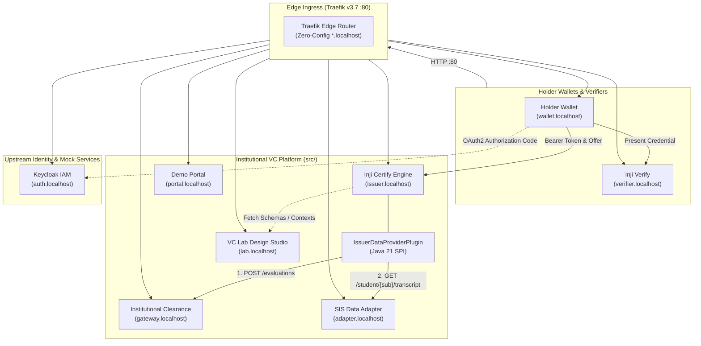
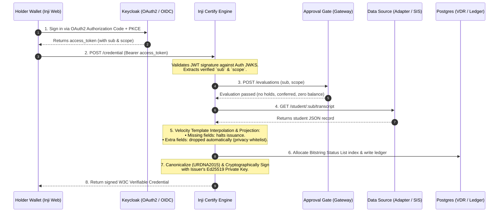
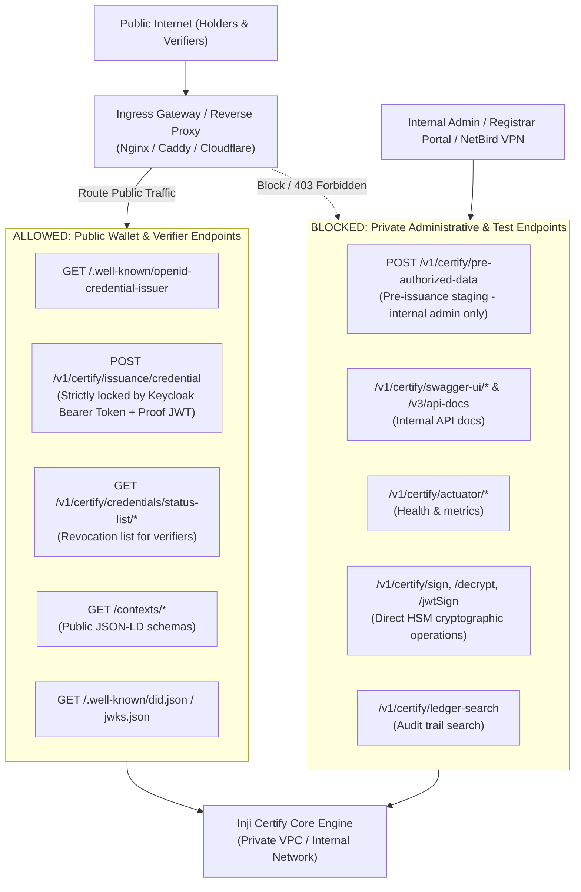

# Institutional Verifiable Credential Platform (AIT Issuer)

An enterprise Verifiable Credential (VC) platform built on **MOSIP Inji Certify**, issuing W3C VCDM 2.0 credentials (JSON-LD with Ed25519Signature2020) via OpenID4VCI.

The platform provides end-to-end credential lifecycle management: visual credential design, dynamic identity resolution, institutional clearance gating, cryptographic signing, Bitstring Status List revocation, and wallet issuance.



---

## 1. Local Environment Overview (Zero-Port Architecture)

The local development environment uses a **pure domain ingress architecture** powered by **Traefik v3.7** on standard HTTP **port 80**.

### Why No Port Numbers to Memorize?
Under [RFC 6761](https://tools.ietf.org/html/rfc6761), every modern operating system and web browser (Chrome, Firefox, Safari, Edge on Linux, macOS, and Windows) natively resolves any subdomain ending in `*.localhost` directly to `127.0.0.1`.
- **No `/etc/hosts` changes required** for local development.
- **Zero host port conflicts**: Downstream service containers do not publish ports directly to your host machine. Only Traefik listens on port 80 (and 8088 for its dashboard).
- **Docker-native isolation**: Containers communicate with each other over internal Docker bridge networks (`certify-network`, `mock-network`, `trust-network`, etc.).

### Local Service Directory

| Service | Clean Local URL (`*.localhost`) | Internal Port | Role & Capabilities |
|---|---|---|---|
| **Traefik Dashboard** | [http://traefik.localhost](http://traefik.localhost) (or [http://localhost:8088](http://localhost:8088)) | `8080` | Live edge ingress routing rules & container health |
| **VC Lab Studio** | [http://lab.localhost](http://lab.localhost) | `4200` | Preview of an uploaded template as the PDF the Wallet prints (through the renderer) |
| **Student Portal** | [http://portal.localhost/student/login](http://portal.localhost/student/login) | `4100` | Student requests transcript & ID credentials |
| **Registrar Portal** | [http://portal.localhost/registrar/login](http://portal.localhost/registrar/login) | `4100` | Academic registrar clearance approval & revocation |
| **Inji Web Wallet** | [http://wallet.localhost](http://wallet.localhost) | `3004` | Holder digital wallet to claim, view, and export credentials |
| **Credential Verifier** | [http://verifier.localhost](http://verifier.localhost) | `8000` | Branded verifier UI with camera QR scanner & JSON drag-and-drop |
| **Inji Certify** | [http://issuer.localhost](http://issuer.localhost) | `80` | OpenID4VCI credential issuer engine & discovery metadata |
| **Certify Swagger UI** | [http://issuer.localhost/v1/certify/swagger-ui/index.html](http://issuer.localhost/v1/certify/swagger-ui/index.html) | `80` | Interactive API exploration & Pre-Authorized Code testing |
| **Keycloak IAM** | [http://auth.localhost](http://auth.localhost) | `8080` | Identity provider & token authority ([Admin Console](http://auth.localhost/admin/): `admin` / `admin`) |
| **SIS Adapter** | [http://adapter.localhost](http://adapter.localhost) | `8000` | Mock SIS student record API (`/student/{sub}/transcript`) |
| **Clearance Gateway** | [http://gateway.localhost](http://gateway.localhost) | `8000` | Institutional checklist evaluator (`/evaluations`) |
| **VDR (Trust Registry)** | [http://vdr.localhost](http://vdr.localhost) | `80` | Public W3C JSON-LD contexts, templates, and brand assets |
| **VCGA (Catalog)** | [http://vcga.localhost](http://vcga.localhost) | `80` | Inji Mimoto trusted issuer registry catalog |

> [!TIP]
> **LAN and Canonical Production Domain Mirroring:**
> Traefik also routes `*.lan` (e.g. `http://wallet.lan`, `http://issuer.lan`) and mirrors canonical production domains `*.dpi.ait.ac.th` (e.g. `http://issuer.dpi.ait.ac.th`) so that container network aliases and local testing match production behavior.

---

## 2. Quickstart: Up and Running in 2 Minutes

### Prerequisites
- **Docker Desktop** (Compose v2) with Linux containers or WSL2 (on Windows).
- **Python 3.11+** and [`uv`](https://github.com/astral-sh/uv) (for running local tools and test suites).
- Standard CLI tools: `curl`, `jq`.

### 1. Boot the Stack
From the repository root:
```bash
# 1. Initialize environment configuration
cp .env.example .env

# 2. Deploy the full platform stack (builds SPI plugin, runs DB migrations, launches Traefik and all services)
./scripts/deploy.sh ait
```

`./scripts/deploy.sh` automatically:
- Builds the Java SPI plugin via an isolated compiler container (no host Maven required).
- Synchronizes GitOps credential templates into PostgreSQL via the `template-sync` init container.
- Boots Traefik, Certify, Keycloak, Portal, Wallet, Verifier, and mock services.
- Executes an automated OpenID4VCI post-deployment issuance smoke test.

### 2. Verify Stack Readiness
Run the post-deployment smoke test anytime:
```bash
./scripts/smoke-test-certify.sh
```
*Expected: Verifies Spring Boot runtime health, PostgreSQL connection, cryptographic signing keys (JWKS & DID document), and OpenID4VCI credential metadata.*

---

## 3. Developer Inner Loops & Everyday Workflows

### Inner Loop 1: Visual Credential Design in VC Lab Studio
When adding or styling a new credential:
1. Open the **VC Lab Studio** dashboard at [http://lab.localhost](http://lab.localhost).
2. Upload a template, a credential file and a sample Adapter response (see [`src/vc-lab/README.md`](./src/vc-lab/README.md)); nothing is built in.
3. See the PDF the Wallet prints in the browser, drawn by the renderer from the same template; upload a Background image to see it on the organisation's paper.

### Inner Loop 2: Fast SPI Plugin Development (`src/issuer/`)
When modifying the Java SPI Data-Provider Plugin (`src/issuer/`):
- **Fast Recompile & Reload (~2s):**
  ```bash
  docker compose -f compose.certify-build.yaml run --rm plugin-builder && docker compose restart certify
  ```
- **Run In-Memory Java Unit Tests (~3s):**
  ```bash
  cd src/issuer && mvn test
  # Or via Docker:
  docker run --rm -v "$PWD/src/issuer:/src" -w /src maven:3.9-eclipse-temurin-21 mvn test
  ```

### Inner Loop 3: GitOps Declarative Credential Sync (`certify-template-sync`)
Credential blueprints are declarative JSON files under `deploy/<installation>/credentials/`.
- **Dry-run inspect template changes:**
  ```bash
  uv run certify-template-sync --dry-run
  ```
- **Apply changes directly to PostgreSQL (zero downtime):**
  ```bash
  uv run certify-template-sync --apply
  ```
  Updating a template only executes an SQL `UPSERT` on `certify.credential_config` without wiping signing keys (`key_store`), ledger audit records (`ledger`), or revocation lists (`status_list`).

### Inner Loop 4: Headless API Exploration & Swagger UI
You do not need Keycloak or a wallet to test Certify endpoints:
- **Interactive Swagger UI:** [http://issuer.localhost/v1/certify/swagger-ui/index.html](http://issuer.localhost/v1/certify/swagger-ui/index.html)
- **OpenAPI 3.0 Documentation:** [http://issuer.localhost/v1/certify/v3/api-docs](http://issuer.localhost/v1/certify/v3/api-docs)
- **Pre-Authorized Issuance via cURL:**
  ```bash
  # 1. Stage issuance offer:
  OFFER_URI=$(curl -s -X POST http://issuer.localhost/v1/certify/pre-authorized-data \
    -H "Content-Type: application/json" \
    -d '{"credential_configuration_id": "ait-transcript", "claims": {"registrationNo": "st120001"}}' \
    | jq -r .credential_offer_uri)

  # 2. Extract offer ID and fetch code:
  OFFER_ID=$(echo "$OFFER_URI" | sed 's/.*credential-offer-data%2F//')
  PRE_AUTH_CODE=$(curl -s "http://issuer.localhost/v1/certify/credential-offer-data/$OFFER_ID" \
    | jq -r '.grants["urn:ietf:params:oauth:grant-type:pre-authorized_code"]["pre-authorized_code"]')

  # 3. Exchange for Access Token:
  ACCESS_TOKEN=$(curl -s -X POST http://issuer.localhost/v1/certify/oauth/token \
    -H "Content-Type: application/x-www-form-urlencoded" \
    -d "grant_type=urn:ietf:params:oauth:grant-type:pre-authorized_code&pre-authorized_code=$PRE_AUTH_CODE" \
    | jq -r .access_token)
  ```

---

## 4. Repository Layout & Module Architecture

```
ait-issuer-platform/
├── scripts/                               # AUTOMATION & PIPELINES
│   ├── deploy.sh                          # Deploy or update platform compose stack
│   ├── release.sh                         # Build and release artifacts/images
│   ├── check.sh                           # Pre-push validation runner (tests + data guard)
│   └── smoke-test-certify.sh              # Inji Certify engine baseline smoke test
│
├── deploy/                               # DEPLOYMENT OVERLAYS & PLATFORM RUNTIME
│   ├── base/                             # Shared Inji platform defaults (properties, nginx, SQL)
│   ├── ait/                              # Academic Transcript tenant profile
│   └── hackathon/                        # Developer Passport & Achievement tenant profile
│
├── tests/                                # INTEGRATION & SYSTEM TEST SUITES
│   ├── test_installations.py             # Tenant identities vs CSV rows
│   ├── test_authorization_server.py      # Authorization server contract tests
│   ├── test_inji_web_vc_readiness.py     # Inji Web OpenID4VCI readiness checks
│   ├── test_issue_and_verify.py          # Scripted issuance and tamper verification
│   └── test_context_refresh.py           # Context and template refresh tests
│
├── src/                                  # CORE SOURCE CODE
│   ├── certify_template_sync/            # Dynamic Inji Certify template synchronizer
│   ├── gateway/                          # Institutional clearance & permission workflow engine
│   ├── issuer/                           # Java 21 SPI Data-Provider Plugin (pom.xml + src/)
│   ├── portal/                           # Demonstration Portal (Registrar & Student UI)
│   ├── tools/                            # Developer utilities (CSV generators, mock rendering)
│   ├── vc-lab/                           # Visual Credential Studio & Designer (FastAPI + Preview)
│   └── verifier/                         # Custom Branded Credential Verifier UI & API
│
├── mock/                                 # OFFLINE DEMO MOCKS
│   └── adapter/                          # Standalone Mock SIS Adapter (FastAPI)
│
├── docs/contracts/                       # API CONTRACTS & SCHEMAS
│   └── adapter-openapi.yaml              # Canonical Adapter OpenAPI 3.1 specification
│
├── docker/                               # CONTAINER PACKAGING RECIPES
│   ├── Dockerfile.ait-vc                 # Unified Python container (Gateway, Portal, Tools, VC Lab, Template Sync)
│   ├── Dockerfile.certify                # Bakes src/issuer SPI plugin into Inji Certify
│   └── Dockerfile.renderer               # VC Lab's renderer: Mimoto 0.21's print path (src/renderer)
│
├── compose.yaml                          # Root orchestrator (includes certify, verify, web-wallet, trust, traefik)
├── compose.certify.yaml                  # Core Inji Certify Issuer Engine (internal DB & ingress Nginx)
├── compose.verify.yaml                   # Generic Inji Verifier stack (UI, backend, session DB)
├── compose.web-wallet.yaml               # Inji Web Wallet UI
├── compose.trust.yaml                    # Trust Registry (Static VDR contexts & VCGA issuer metadata)
├── compose.mock.yaml                     # Stand-in mock services (Keycloak, adapter, portal)
├── compose.traefik.yaml                  # Traefik v3.7 Edge Ingress Router (*.localhost)
├── compose.certify-build.yaml            # Compiler container for Java SPI plugin
├── .env.example                          # Root developer environment configuration
└── pyproject.toml / uv.lock              # Modern Python dependency management (uv)
```

---

## 5. How Credential Issuance Works (Lifecycle & Data Flow)

Understanding the complete OpenID4VCI credential lifecycle requires four architectural pillars:

```
    1. Schema & Context              2. Authentication             3. Certify Blueprint              4. Data Source
      (`src/vc-lab/`)                 (OIDC / Keycloak)           (Postgres `credential_config`)      (SIS / Adapter)
  Public JSON-LD vocabulary       User logs in via OAuth2       Velocity `vc_template`, Key Alias,   Returns subject records
  defines terms & signature       provides verified `sub`       and W3C Bitstring Status List        via `CERTIFY_RECORD_URL`
```

### The 5-Step Issuance Pipeline



#### Detailed Pipeline Breakdown:

1. **Authentication & Identity Anchor:**
   - The holder signs into Keycloak. Certify verifies the Bearer JWT signature against Keycloak's JWKS endpoint (`AUTH_SERVER_JWKS_URL`).
   - Certify extracts the authenticated `sub` (student identifier) and requested `scope`. The user cannot query another person's record.

2. **Institutional Clearance Gate:**
   - When enabled, the DataProvider plugin calls Gateway (`POST /evaluations`).
   - The Gateway evaluates institutional clearance checks (holds, conferral status, tuition balance). Refusal fails closed.

3. **Data Retrieval:**
   - The plugin calls the configured upstream endpoint (`CERTIFY_RECORD_URL`), substituting `{sub}` with the token's identity.

4. **Template Resolution & Privacy Projection:**
   - Certify's internal Velocity engine loads the `vc_template` from `credential_config` matching the requested scope.
   - **Missing Fields:** If a template placeholder (e.g. `${fullName}`) is absent, template rendering fails and issuance halts.
   - **Extra Fields:** If the database returns additional attributes (e.g. `internal_db_id`, `motherName`), they are **silently dropped** because the template only renders explicit slots. The template acts as a privacy projection filter.

5. **Cryptographic Signing & Status List (VDR):**
   - **Status List Allocation:** Certify assigns an index in the W3C **Bitstring Status List** and logs an immutable audit row in `certify.ledger`.
   - **Cryptographic Proof:** The document is canonicalized into RDF triples (URDNA2015) and signed with the Issuer's private key (`Ed25519Signature2020`).
   - **Delivery:** The finalized W3C VC is delivered to the wallet. When Inji Verify checks the credential later, it fetches the public `@context` and verifies the status bit to ensure it has not been revoked.

---

### Security Architecture: Public vs. Private Ingress Boundary

Because Inji Certify serves both public wallet protocols and internal cryptographic/administrative endpoints, **Certify must never be exposed directly to the public internet without an ingress gateway (Reverse Proxy)**.



---

## 6. How to Test

All test suites are automated and runnable locally on your host or in CI.

### Fast Pre-Push Validation (`scripts/check.sh`)
Run the unified project validation script before committing or pushing:
```bash
bash scripts/check.sh
```
This runs:
1. **Sensitive Data Guard**: Ensures no `.env`, private keys, or CSV student data are tracked.
2. **Docker Compose Validation**: Ensures all 7 Compose manifests are syntactically valid.
3. **JSON Schema Verification**: Ensures all schemas, templates, and fixtures are well-formed.
4. **Host Test Suite**: Runs all in-process Python verification suites.

### Unit & Host Test Directory
```bash
# Host verification tests (no Docker required):
python3 src/tools/test_generate_csv.py
python3 src/tools/test_render_mimoto_issuers_config.py
python3 src/verifier/test_verifier.py
python3 tests/test_installations.py
python3 tests/test_authorization_server.py
python3 tests/test_inji_web_vc_readiness.py

# Tests requiring virtual environment (FastAPI, cryptography, httpx):
.venv/bin/python tests/test_issue_and_verify.py
.venv/bin/python tests/test_adapter.py
.venv/bin/python tests/test_courses.py
.venv/bin/python src/gateway/tests/test_credential_types.py
.venv/bin/python src/gateway/tests/test_evaluations.py
.venv/bin/python src/portal/test_requests.py
.venv/bin/python src/vc-lab/test_main.py

# Run Java plugin unit tests:
cd src/issuer && mvn test
```

| Module | Test Target | What It Verifies |
|---|---|---|
| **VC Lab** | `src/vc-lab/test_main.py` | The upload-only API, the claim mapping, and the request it sends the renderer |
| **Gateway** | `src/gateway/tests/test_credential_types.py` | Credential clearance rules, hold checks, zero balance, conferral predicates |
| **Gateway** | `src/gateway/tests/test_evaluations.py` | In-process evaluation of `POST /evaluations` across all installation personas |
| **Issuer Plugin** | `src/issuer/` (`mvn test`) | SPI `fetchData()` contract, HTTP retry/timeouts, strict JSON escaping, trace keys |
| **Adapter Contract** | `tests/test_adapter.py` | Validates OpenAPI contracts (`adapter-openapi.yaml`) against VCDM 2.0 schemas |
| **Portal** | `src/portal/test_requests.py` | Student request workflow, registrar approvals, and active VC re-issue guards |
| **Verifier** | `src/verifier/test_verifier.py` | Verifier UI branding overlay, CSS theme variables, SVG logo |
| **Auth Server** | `tests/test_authorization_server.py` | Validates OIDC issuer URLs, Keycloak realm mappings, and public endpoints |
| **Installations** | `tests/test_installations.py` | Verifies identities across CSV, Keycloak realms, and smoke personas |

---

## 7. Stakeholder End-to-End Walkthrough

To experience the complete stakeholder journey:
1. Open **Student Portal** ([http://portal.localhost/student/login](http://portal.localhost/student/login)) $\rightarrow$ Select `Nara Wattanakul` (`st120001`) $\rightarrow$ Click **Request my transcript VC**.
2. Open **Registrar Portal** ([http://portal.localhost/registrar/login](http://portal.localhost/registrar/login)) $\rightarrow$ Sign in as Academic Registrar $\rightarrow$ Click **Approve**.
3. Return to Student Portal $\rightarrow$ Click **Claim your credential** $\rightarrow$ Redirects to **Inji Web** ([http://wallet.localhost](http://wallet.localhost)).
4. In Inji Web, sign in (`st120001` / `password1234`), select **AIT University**, and download the **AIT Transcript**.
5. Open **Credential Verifier** ([http://verifier.localhost](http://verifier.localhost)) $\rightarrow$ Upload the downloaded credential JSON or scan QR code $\rightarrow$ Verdict reports **Authentic Credential Verified**.
6. Design and preview credential templates in **VC Lab Studio** ([http://lab.localhost](http://lab.localhost)).

---

## 8. Deploying to GCP & Production Domains

The demonstration environment is continuously deployed to a Google Compute Engine VM (`ait-vc-transcript-demo`) behind Caddy (TLS) and NetBird Zero-Trust Mesh.

### Production Domain Architecture (*.dpi.ait.ac.th)
Permanent institutional endpoints for cryptographic schema resolution, issuance, and verification:
- **Issuer Engine:** `https://issuer.dpi.ait.ac.th`
- **Credential Verifier:** `https://verifier.dpi.ait.ac.th` (or `https://verifer.dpi.ait.ac.th`)
- **Inji Web Wallet:** `https://wallet.dpi.ait.ac.th`
- **VDR (Schemas, Templates & Assets):** `https://vdr.dpi.ait.ac.th`
- **VCGA (Issuers Catalog):** `https://vcga.dpi.ait.ac.th`

### Staging Demo Web Ingress (TLS / Caddy)
These public endpoints are internet-facing on the demo VM for student holders and external verifiers:
- **Student Portal:** `https://transcript-demo.ait-vc.dpi.ait.ac.th/student/login`
- **Registrar Portal:** `https://transcript-demo.ait-vc.dpi.ait.ac.th/registrar/login`
- **Inji Web Wallet:** `https://wallet.transcript-demo.ait.ac.th`
- **Inji Verify:** `https://verify.transcript-demo.ait-vc.dpi.ait.ac.th`
- **Issuer Metadata & Issuance:** `https://api.transcript-demo.ait-vc.dpi.ait.ac.th/.well-known/openid-credential-issuer` (routed via Caddy to `certify-nginx:8090`)

### Private Administrative & API Access via NetBird VPN
To protect sensitive administrative functions and pre-authorized issuance, internal ports are **never exposed to the public internet**:
- **GCP Firewall Policy:** Only inbound ports `80` and `443` are open to `0.0.0.0/0`. Direct engine ports are blocked from public internet access.
- **NetBird Mesh Overlay:** The GCP VM joins the campus private NetBird WireGuard network (alongside campus infrastructure like `ait-itserv-vm.netbird.selfhosted`).
- **Zero-Trust Access:** Authorized administrators, engineers, and campus backend systems connected to NetBird access internal services directly using the VM's NetBird IP (`100.x.y.z`) or hostname without bastion hosts or SSH tunneling:
  - **Interactive Swagger UI:** `http://<vm-netbird-ip>:9091/v1/certify/swagger-ui/index.html`
  - **Pre-Authorized Issuance API:** `POST http://<vm-netbird-ip>:9091/v1/certify/pre-authorized-data`
  - **SIS Adapter Contract Verification:** `http://<vm-netbird-ip>:8000/student/{sub}/eligibility`
  - **Health & Actuator Metrics:** `http://<vm-netbird-ip>:9091/v1/certify/actuator/health`

### Continuous Deployment
Continuous Deployment is automated via GitHub Actions (`.github/workflows/cd.yml`) across three environments:
- **dev**: Deployed on tag push (`v*`) cut from `dev` branch to the development VM.
- **uat**: Deployed on fast-forward push to `uat` branch (`scripts/release.sh promote uat`).
- **production**: Deployed on fast-forward push to `main` branch (`scripts/release.sh promote main`).

Target hosts execute `scripts/deploy.sh` over an encrypted NetBird mesh network via SSH.

---

## 9. Documentation Index

- [Documentation Overview (`docs/OVERVIEW.md`)](./docs/OVERVIEW.md)
- [Day-0 Deployment Roadmap (`docs/guides/day-0-deployment.md`)](./docs/guides/day-0-deployment.md)
  - [Stage 1: Inji Certify Day-0 Guide (`docs/guides/day-0-certify.md`)](./docs/guides/day-0-certify.md)
  - [Stage 2: Inji Web Wallet Day-0 Guide (`docs/guides/day-0-wallet.md`)](./docs/guides/day-0-wallet.md)
  - [Stage 3: Inji Verify Day-0 Guide (`docs/guides/day-0-verify.md`)](./docs/guides/day-0-verify.md)
- [How to Add a New Verifiable Credential (`docs/guides/how-to-add-vc.md`)](./docs/guides/how-to-add-vc.md)
- [VC Lab Studio & Template Designer (`src/vc-lab/README.md`)](./src/vc-lab/README.md)
- [Architecture & Topology (`docs/architecture/vc-stack.md`)](./docs/architecture/vc-stack.md)
- [ADR 0001: Approval Gate Beside the Data Path](./docs/adr/0001-approval-gate-beside-the-data-path.md)
- [CI/CD & Deployment Architecture (`docs/deployment.md`)](./docs/deployment.md)
- [Inji Certify Standalone Deployment (`deploy/README.md`)](./deploy/README.md)
- [Gateway Workflow Engine (`src/gateway/README.md`)](./src/gateway/README.md)
- [Verifier Custom Theme & Overlay (`src/verifier/README.md`)](./src/verifier/README.md)

---

## 10. Standards Compliance & Architecture Roadmap (TODO)

Tracked architectural enhancements for future upstream alignment and standards compliance:

| Area | Current Implementation | Standards Target | Action / Tracking |
|:---|:---|:---|:---|
| **W3C Cryptosuite** | CCG `Ed25519Signature2020` with VCDM 2.0 context | **W3C Data Integrity 1.0** (`eddsa-rdfc-2022` / `eddsa-jcs-2022`) | Upgrade proof suite when upstream MOSIP Inji Certify ships Data Integrity 1.0 support. |
| **Course Data Model** | `@type: @json` opaque JSON literal | **Semantic Linked Data** (W3C Edu-VC / Schema.org `Course`) | Model courses, grades, and credits as typed RDF entities rather than unindexed JSON blobs. |
| **OpenID4VCI Nonces** | Stand-in Keycloak hardcoded `c_nonce` mapper (`local-cnonce`) | **Dynamic Credential Issuer Nonces** | Implement dynamic single-use `c_nonce` challenge-response via OpenID4VCI Credential / Nonce endpoint. |
| **Multi-Credential Routing** | Single static `record-url` per Certify instance | **Scope-Aware Dynamic Routing** | Pass requested credential `scope` to Adapter so multiple credentials (e.g. Student ID vs. Transcript) route to dedicated REST endpoints. |
| **Canonical Domain** | `https://ait.example/` in schema and context | **Production University Domain** | Migrate placeholder `ait.example` IRIs to canonical `https://credentials.ait.ac.th/` or `https://vdr.dpi.ait.ac.th/`. |

