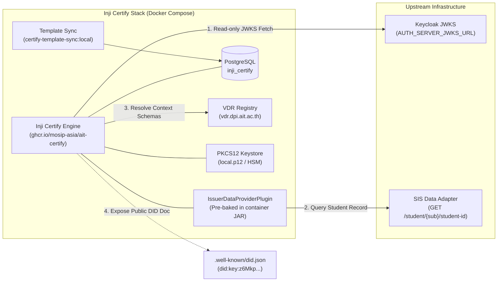

# Stage 1: Inji Certify Day-0 Deployment Guide

This guide covers the **initial (Day-0) deployment of Inji Certify**, the core credential issuer engine of the platform.



> [!IMPORTANT]
> **Decoupled Architecture:**
> Inji Certify is an **OAuth 2.0 Resource Server**, NOT an OAuth client.
> - Certify does **not** register as a client in Keycloak.
> - Keycloak has **zero** knowledge of Certify.
> - Certify only reads Keycloak's public keys (`AUTH_SERVER_JWKS_URL`) to verify token signatures when a wallet presents an access token.
> 
> **Day-0 Deployment Scope (Student ID First):**
> In Day-0, Certify is configured to issue the **AIT Student ID Card** (`StudentIdCredential`, `AitIdCredential`) via scope `ait_student_id_vc_ldp` reading from `GET /student/{sub}/student-id`. Academic Transcript issuance via `GET /student/{sub}/transcript` is deferred to Phase 2.

---

## 1. Tenant Configuration Structure (`deploy/<tenant>/certify/`)

All Certify-dependent configuration for a tenant (Velocity templates, database seed SQL, properties, and verification config) is isolated under `deploy/<tenant>/certify/`:

```
deploy/ait/certify/
├── certify-installation.properties    # Certify Spring properties (adapter URL, gate toggle, timeouts)
├── certify_seed.sql                  # PostgreSQL seed inserting credential_config rows
├── vp_request_config.json            # Presentation request configuration
└── credentials/                      # Inji Certify credential definitions & Velocity templates
    ├── ait-transcript.json           # AIT Transcript: claims, scope, and Velocity signing template
    └── ait-student-id.json           # AIT Student ID Card credential definition
```

### Key Tenant Files:
1. **`credentials/*.json` (Velocity Templates)**:
   Contains the W3C credential schema, scope, and the `vc_template` Velocity template string that Certify populates when signing credentials.
2. **`certify-installation.properties`**:
   Configures Certify's `IssuerDataProviderPlugin`, specifying the `CERTIFY_RECORD_URL`, timeouts, allowed audiences, and `did-url`.
3. **`certify_seed.sql`**:
   Contains the SQL statements used to initialize or refresh the database. (Also synchronized automatically on boot by `template-sync`).

---

## 2. Upstream Data Source Integration (`sis-adapter`)

Inji Certify's `IssuerDataProviderPlugin` queries your university's Student Information System (SIS) API.

### API Contract (`docs/contracts/adapter-openapi.yaml`)

For Day-0 Student ID issuance, the SIS Adapter serves:
```http
GET /student/{sub}/student-id
```
- **Path Parameter**: `{sub}` is the student's registration ID (e.g. `st120001`).
- **Response**: HTTP 200 with JSON payload (`StudentIdRecord`):
  ```json
  {
    "studentId": "st120001",
    "fullName": "Nara Wattanakul",
    "affiliation": "Student",
    "faculty": "School of Engineering and Technology",
    "academicProgram": "M.Eng Computer Science",
    "studentStatus": "Active",
    "issueDate": "2026-09-17",
    "expiryDate": "2027-09-17"
  }
  ```
- **Status Codes**:
  - `200 OK`: Valid student record.
  - `404 Not Found`: Student does not exist or user is not a student (Certify fails closed with `no_record`).
  - `500 Internal Error`: Adapter error (Certify returns `adapter_error`).

*(Note: For Phase 2 Academic Transcript issuance, the Adapter also serves `GET /student/{sub}/transcript` with full course grades, GPA, credits, and degree conferral details).*

---

## 3. Cryptographic Identity & Keystore Configuration (`did:key`)

### A. What is `did:key`?
`did:key` is a W3C Decentralized Identifier method where the cryptographic public key is encoded directly inside the identifier string itself:
- Format: `did:key:z6Mkp...` (for Ed25519 signing keys).
- The `z` prefix indicates Multibase Base58btc encoding, and the bytes encode the Ed25519 public key multicodec (`0xed01` prefix followed by the 32-byte public key).
- **Why this matters**: Any verifier worldwide can verify credentials issued by `did:key` completely offline without querying a blockchain or external server.

### B. Keystore Configuration & Lifecycle Management

Certify loads its Ed25519 private key from the keystore mounted into `/home/inji/CERTIFY_PKCS12/local.p12`:
- Keystore file: `deploy/<tenant>/private_key/CERTIFY_PKCS12/local.p12`
- Configurable environment variables:
  ```ini
  KEYSTORE_TYPE=PKCS12
  KEYSTORE_PASS=local
  ```
  *(For production environments using a Hardware Security Module, `KEYSTORE_TYPE=PKCS11` is used).*

#### How the Keystore is Created & Managed:
You can provision and manage `local.p12` using one of the following methods:

1. **Option 1: Automatic Keystore Provisioning & DID Synchronization via `deploy.sh` (Recommended / Zero-Manual Setup)**
   The deployment runner `./scripts/deploy.sh <tenant>` handles the entire keystore and DID lifecycle automatically:
   - On initial Day-0 deployment, if `deploy/<tenant>/private_key/CERTIFY_PKCS12/local.p12` does not exist, `deploy.sh` automatically creates the parent directory and generates a fresh Ed25519 keypair inside `local.p12` (ensuring `0644` file permissions so container user `inji` UID 1001 can read it).
   - It extracts the live public multibase key (`did:key:z6Mk...`) using `tools did --p12`.
   - It automatically synchronizes `CERTIFY_DID` inside `.env` before launching the Docker Compose stack.
   - **Direct Database Seeding (`template-sync`)**: The `template-sync` service mounts `local.p12` directly (`/app/keys/CERTIFY_PKCS12/local.p12:ro`) and reads the public key directly from the keystore, automatically seeding `credential_config.did_url` in PostgreSQL without manual copy-pasting.

2. **Option 2: Pre-generate or Inspect Keystore Manually via `tools did` (Offline / Standalone CLI)**
   If you want to generate or inspect the keystore ahead of time before running deployment:

   - **Generate a new keystore via Docker** (no host Python or dependencies required):
     ```bash
     docker run --rm --user "$(id -u):$(id -g)" -v "$(pwd):/work" -w /work \
       ghcr.io/mosip-asia/ait-vc:${IMAGE_TAG:-latest} \
       tools did --generate deploy/ait/private_key/CERTIFY_PKCS12/local.p12
     ```

   - **Generate a new keystore via `uv` (Local Development)**:
     ```bash
     uv run tools did --generate deploy/ait/private_key/CERTIFY_PKCS12/local.p12
     ```

   - **Inspect and extract `did:key` from an existing `.p12` keystore**:
     ```bash
     # Via Docker
     docker run --rm -v "$(pwd):/work" -w /work \
       ghcr.io/mosip-asia/ait-vc:${IMAGE_TAG:-latest} \
       tools did --p12 deploy/ait/private_key/CERTIFY_PKCS12/local.p12

     # Or via uv
     uv run tools did --p12 deploy/ait/private_key/CERTIFY_PKCS12/local.p12
     ```

   > [!TIP]
   > **Permission Denied Troubleshooting**: If Inji Certify previously ran on this host, Docker may have created `deploy/<tenant>/private_key/CERTIFY_PKCS12` owned by `root` or `inji` (UID 1001). If generating a keystore fails with permission denied, remove the old directory first:
   > ```bash
   > sudo rm -rf deploy/ait/private_key/CERTIFY_PKCS12
   > ```

3. **Option 3: Manual Generation via OpenSSL CLI (Low-Level Fallback)**
   If creating the keystore manually using standard Linux utilities without Python:
   ```bash
   mkdir -p deploy/ait/private_key/CERTIFY_PKCS12
   openssl genpkey -algorithm ED25519 -out /tmp/ed25519-key.pem
   openssl req -new -x509 -key /tmp/ed25519-key.pem -out /tmp/ed25519-cert.pem -days 3650 \
     -subj "/C=TH/ST=Bangkok/O=AIT/CN=CERTIFY_VC_SIGN_ED25519"
   openssl pkcs12 -export -in /tmp/ed25519-cert.pem -inkey /tmp/ed25519-key.pem \
     -out deploy/ait/private_key/CERTIFY_PKCS12/local.p12 -name CERTIFY_VC_SIGN_ED25519 -passout pass:local
   chmod 644 deploy/ait/private_key/CERTIFY_PKCS12/local.p12
   rm -f /tmp/ed25519-key.pem /tmp/ed25519-cert.pem
   ```

---

### C. ⚠️ Critical Invariant: Strict Immutability of `CERTIFY_DID` and Keystore

> [!CAUTION]
> ### ONCE ISSUANCE COMMENCES, `CERTIFY_DID` AND `local.p12` CAN NEVER BE CHANGED!
>
> In W3C Verifiable Credentials using the `did:key` method:
> 1. **Cryptographic Signature Binding**: Every signed credential embeds the issuer's identifier and proof:
>    ```json
>    {
>      "issuer": "did:key:z6MkhsC1EojKdBoLzPY2kL2mFLSMJbQVC83M2CsnYGwghcsE",
>      "proof": {
>        "type": "Ed25519Signature2020",
>        "verificationMethod": "did:key:z6MkhsC1EojKdBoLzPY2kL2mFLSMJbQVC83M2CsnYGwghcsE#key-1"
>      }
>    }
>    ```
> 2. **Global Verification Failure**: Per W3C specifications, verifiers (such as Inji Verify, third-party employer verification systems, and other universities) verify the digital signature using **only** the public key encoded inside the `did:key` string.
> 3. **Catastrophic Impact of Key / DID Changes**:
>    - If `CERTIFY_DID` or `local.p12` is modified, regenerated, or replaced, **EVERY CREDENTIAL PREVIOUSLY ISSUED TO STUDENTS OR HOLDERS BECOMES PERMANENTLY UNVERIFIABLE AND INVALID**.
>    - Any student presenting an existing Student ID or Academic Transcript to a verifier will fail with a cryptographic signature mismatch error (`FAILED_SIGNATURE`).
> 4. **Revocation Authority Lost**: W3C Bitstring Status Lists and StatusList2021 are signed and controlled by the original issuer DID. A new DID has no authority to update or revoke credentials issued under a previous DID.
> 5. **Backup & Disaster Recovery Requirement**:
>    - Treat `deploy/<tenant>/private_key/CERTIFY_PKCS12/local.p12` and `CERTIFY_DID` in `.env` as **permanent institutional root secrets**.
>    - Back up the keystore file to secure, encrypted disaster-recovery storage.
>    - Never delete or wipe the keystore volume after initial issuance begins.

---

### D. How `CERTIFY_DID` and Keystore Key Derivation Work

> [!IMPORTANT]
> **Understanding Certify's DID Document Architecture:**
> In Inji Certify:
> 1. **Cryptographic Public Key (Derived from Keystore)**: On startup, Certify loads the Ed25519 signing certificate from the keystore (`local.p12` under alias `CERTIFY_VC_SIGN_ED25519`), extracts the raw 32-byte public key, prepends the multicodec `0xed01`, and encodes it in Base58btc with prefix `z`. This is exposed dynamically inside the DID document at `.verificationMethod[0].publicKeyMultibase` (e.g. `z6MknvXD49undgXJCPeXFhVr4abNqu1S7jWqeSvis2PFr6EH`).
> 2. **DID Document Root Identifier (`.id`) & Controller**: Certify does **not** dynamically synthesize `.id` from the keystore key. Instead, it reads the configured `did_url` from the database table `certify.credential_config` (which `template-sync` populates) and from its environment properties (`mosip.certify.data-provider-plugin.did-url=${CERTIFY_DID}`).
> 
> **Eliminating the Chicken-and-Egg Bootstrap Trap:**
> Historically, if `CERTIFY_DID` was unconfigured, running `curl .../.well-known/did.json | jq -r .id` returned a placeholder, requiring manual query of `.verificationMethod[0]`, editing `.env`, and restarting containers.
> 
> In this platform, the chicken-and-egg problem is fully automated:
> 1. **Pre-flight Synchronization (`deploy.sh`)**: When you run `./scripts/deploy.sh <tenant>`, it checks `deploy/<tenant>/private_key/CERTIFY_PKCS12/local.p12`. If missing, it generates it; then it extracts the `did:key` using `tools did --p12` and writes it to `CERTIFY_DID` in `.env` *before* starting Docker Compose.
> 2. **Direct Keystore Reading (`template-sync`)**: `template-sync` mounts `local.p12` directly into `/app/keys/CERTIFY_PKCS12/local.p12:ro`. It inspects `local.p12` on startup to extract the genuine `did:key` and seeds PostgreSQL directly, eliminating discrepancies between `.env`, the database, and the signing key.
> 3. **Certify Boot**: Certify boots with both `.id` and `.verificationMethod[0]` matching the exact key in `local.p12`.
> 
> **Manual Inspection & Verification:**
> If you ever want to verify or inspect the key:
> ```bash
> # Extract from the live running Certify service:
> curl -sf https://issuer.dpi.ait.ac.th/.well-known/did.json | jq -r '"did:key:" + .verificationMethod[0].publicKeyMultibase'
> 
> # Or inspect the local.p12 keystore directly using Docker:
> docker run --rm -v "$(pwd):/work" -w /work ghcr.io/mosip-asia/ait-vc:${IMAGE_TAG:-latest} tools did --p12 deploy/ait/private_key/CERTIFY_PKCS12/local.p12
> 
> # Or using uv on host:
> uv run tools did --p12 deploy/ait/private_key/CERTIFY_PKCS12/local.p12
> ```

### E. How `CERTIFY_DID` and the Keystore are Applied
- **`deploy.sh`**: Auto-populates `CERTIFY_DID` in `.env` based on `local.p12`.
- **`template-sync`**: Reads `local.p12` directly to extract the multibase public key and updates every credential definition in PostgreSQL (`credential_config.did_url`).
- **`certify-installation.properties`**: Reads `mosip.certify.data-provider-plugin.did-url=${CERTIFY_DID}` and stamps it as the `issuer.id` inside every signed Verifiable Credential.

---

## 4. Token Verification Endpoint (`AUTH_SERVER_JWKS_URL`)

### A. What is `AUTH_SERVER_JWKS_URL`?
Inji Certify is an **OAuth 2.0 Resource Server**. When a student requests a credential, their wallet presents a JWT Bearer access token issued by campus Keycloak:
- The token is signed using Keycloak's private key and carries a Key ID (`kid`) in its header.
- Certify needs Keycloak's public keys to verify that the token is genuine, has not expired, and has not been tampered with.
- Keycloak publishes its public keys at its **JSON Web Key Set (JWKS)** endpoint.

### B. How to Discover `AUTH_SERVER_JWKS_URL`
You can discover the exact JWKS endpoint using standard OpenID Connect discovery:
```bash
curl -sf https://oauth-dev.ait-itserv.dpi.ait.ac.th/realms/ait-dev/.well-known/openid-configuration | jq -r .jwks_uri
```
*Expected Output:*
```text
https://oauth-dev.ait-itserv.dpi.ait.ac.th/realms/ait-dev/protocol/openid-connect/certs
```

### C. How to Configure in `.env`
Set the discovered URLs in `.env`:
```ini
AUTH_SERVER_ISSUER=https://oauth-dev.ait-itserv.dpi.ait.ac.th/realms/ait-dev
AUTH_SERVER_JWKS_URL=https://oauth-dev.ait-itserv.dpi.ait.ac.th/realms/ait-dev/protocol/openid-connect/certs
```

### D. How Certify Validates Incoming Access Tokens (Wallet-Agnostic Design)
Inji Certify is an **OAuth 2.0 Resource Server (RS)** and is completely **wallet-agnostic**. It does not care which wallet (Inji Web, AI4DPI Mobile Wallet, or any other OpenID4VCI-compliant wallet) sends the request.

In `deploy/<tenant>/certify/certify-installation.properties`, Certify defines its allowed audiences strictly as its protected credential endpoints:
```properties
mosip.certify.authn.allowed-audiences={ 
  'http://certify-nginx:80/v1/certify/issuance/credential', 
  'http://certify-nginx/v1/certify/issuance/credential', 
  '${mosip.certify.domain.url}/v1/certify/issuance/credential' 
}
```

When any wallet calls `POST /v1/certify/issuance/credential` with `Authorization: Bearer <token>`:
1. Certify downloads Keycloak's public keys from `AUTH_SERVER_JWKS_URL` (keys are cached automatically in memory).
2. Certify matches the token's `kid` against Keycloak's public keys and verifies the cryptographic signature (e.g. RS256).
3. Certify validates that `token.iss == AUTH_SERVER_ISSUER`.
4. **Audience Verification**: Certify verifies that `token.aud` matches any of its allowed credential endpoints (`${mosip.certify.domain.url}/v1/certify/issuance/credential`). Certify accepts it from **any** wallet client whose token targets this endpoint.
5. Certify extracts `sub` (the student ID) and calls `IssuerDataProviderPlugin`.
6. Certify inspects `token.claims.get("client_id")` and logs the requesting client ID into `certify.ledger` for audit tracking.

If the signature fails, or if `iss` or `aud` does not match, Certify immediately returns HTTP 401 (`invalid_access_token`).

### E. Holder Key Binding Support (`did:jwk` & `did:key`)
Inji Certify supports both standard holder key binding methods in `cryptographic_binding_methods_supported`:
- **`did:jwk`**: Used by web-based wallets (e.g. Inji Web Wallet) generating browser-held ES256/RS256 keys.
- **`did:key`**: Used by native mobile wallets (e.g. AI4DPI Inji Mobile Wallet) aligned with Thailand ETDA recommendations.

During issuance, Certify extracts the holder's public key from the OpenID4VCI proof JWT header (`kid`) and binds it as the credential subject's identifier (`credentialSubject.id = "${_holderId}"`).

---

## 5. Complete `.env` Reference for Certify Day-0

```ini
# ==============================================================================
# Inji Certify Day-0 Configuration (.env)
# ==============================================================================
COMPOSE_PROJECT_NAME=vc-stack
INSTALLATION=ait
IMAGE_TAG=latest

# Edge Ingress & Domains
CERTIFY_PUBLIC_BASE_URL=https://issuer.dpi.ait.ac.th
VDR_BASE_URL=https://vdr.dpi.ait.ac.th

# Cryptographic Identity & Keystore
# Automatically synchronized from deploy/<tenant>/private_key/CERTIFY_PKCS12/local.p12 by deploy.sh:
CERTIFY_DID=did:key:z6MknvXD49undgXJCPeXFhVr4abNqu1S7jWqeSvis2PFr6EH
KEYSTORE_TYPE=PKCS12
KEYSTORE_PASS=local

# Upstream SIS Data Adapter (NetBird VPN or campus network)
# For Day-0 Student ID deployment, point to the student-id endpoint:
CERTIFY_RECORD_URL=http://ait-itserv-dev-vm.netbird.selfhosted:8000/student/{sub}/student-id

# Approval Gate (Keep disabled for Day-0 to test direct adapter data retrieval first)
MOSIP_CERTIFY_GATEWAY_ENABLED=false
MOSIP_CERTIFY_GATEWAY_URL=NO GATEWAY

# Token Verification (Campus Keycloak - oauth-dev)
AUTH_SERVER_ISSUER=https://oauth-dev.ait-itserv.dpi.ait.ac.th/realms/ait-dev
AUTH_SERVER_JWKS_URL=https://oauth-dev.ait-itserv.dpi.ait.ac.th/realms/ait-dev/protocol/openid-connect/certs
```

---

## 6. Step-by-Step Day-0 Execution Runbook

### Step 1: Pre-flight Network & Config Verification
1. Ensure the deployment host has network reachability to both campus Keycloak JWKS and the SIS Adapter:
   ```bash
   # Verify Keycloak JWKS is reachable
   curl -sf https://oauth-dev.ait-itserv.dpi.ait.ac.th/realms/ait-dev/protocol/openid-connect/certs | jq .

   # Verify SIS Adapter is reachable from the host (e.g. over NetBird VPN)
   curl -sf http://ait-itserv-dev-vm.netbird.selfhosted:8000/student/st120001/student-id | jq .
   ```

2. Validate environment configuration integrity:
   ```bash
   # Verify all required .env variables exist and are non-empty
   bash scripts/check-env.sh
   ```

### Step 2: Container Image Resolution (Pre-baked vs Local Plugin Build)
- **Standard / Server Deployment (GHCR)**:
  The `IssuerDataProviderPlugin` SPI is pre-compiled and baked directly into `ghcr.io/mosip-asia/ait-certify:${IMAGE_TAG}` at `/home/inji/additional_jars/issuer-data-provider-plugin.jar`. No Maven toolchain or local JAR compilation is needed on the deployment server.

- **Local Developer Iteration (Optional)**:
  If actively modifying plugin Java source code in `src/issuer/`:
  ```bash
  # Build plugin JAR and container image locally
  ./scripts/build.sh
  # Or compile JAR only via containerized builder
  docker compose -f compose.certify-build.yaml run --rm plugin-builder
  ```

### Step 3: Launch Certify & Trust Services
Deploy using the automated deployment runner:
```bash
# Automated deployment (provisions keystore, synchronizes CERTIFY_DID in .env, pulls images, validates config, and starts containers)
./scripts/deploy.sh ait
```
Or start the containers manually via Docker Compose (if `local.p12` already exists and `CERTIFY_DID` is already synchronized in `.env`):
```bash
docker compose -f compose.certify.yaml -f compose.trust.yaml -f compose.traefik.yaml up -d
```

### Step 4: Verify Keystore `did:key` & Cryptographic Binding
Because `./scripts/deploy.sh` and `template-sync` handle keystore detection, key derivation, `.env` synchronization, and database seeding automatically, manual editing of `.env` is no longer required on Day-0.

Confirm that the live public key matches across Certify, the database, and `.env`:
```bash
# 1. Query Certify's DID document to retrieve the genuine public key derived from the keystore (local.p12):
LIVE_DID=$(curl -sf https://issuer.dpi.ait.ac.th/.well-known/did.json | jq -r '"did:key:" + .verificationMethod[0].publicKeyMultibase')
echo "Live Keystore-derived Issuer DID: $LIVE_DID"

# 2. Check the DID document root ID:
DOC_ID=$(curl -sf https://issuer.dpi.ait.ac.th/.well-known/did.json | jq -r .id)
echo "DID Document Root ID: $DOC_ID"

# 3. Check CERTIFY_DID configured in .env:
grep CERTIFY_DID .env
```
All three values should match identically (`did:key:z6Mk...`).

> [!NOTE]
> - Do not query `.id` alone to determine the signing key; as explained in [Section 3.D](#d-how-certify_did-and-keystore-key-derivation-work), `.id` reflects the configured `CERTIFY_DID` while `.verificationMethod[0].publicKeyMultibase` reflects the actual keystore public key.
> - You can also inspect `local.p12` directly using Docker: `docker run --rm -v "$(pwd):/work" -w /work ghcr.io/mosip-asia/ait-vc:${IMAGE_TAG:-latest} tools did --p12 deploy/ait/private_key/CERTIFY_PKCS12/local.p12` (or on host via `uv run tools did --p12 deploy/ait/private_key/CERTIFY_PKCS12/local.p12`).
> - If you ever replace or restore `local.p12` from backup, simply re-run `./scripts/deploy.sh ait` to re-synchronize `.env` and restart containers cleanly.

### Step 5: Verify Service Health
1. **Run Automated Smoke Tests**:
   ```bash
   bash scripts/smoke-test-certify.sh
   ```
   Validates database connectivity, cryptographic key loading, and OpenID4VCI discovery metadata.

2. **Check OpenID4VCI Issuer Discovery Endpoint**:
   ```bash
   curl -sf https://issuer.dpi.ait.ac.th/.well-known/openid-credential-issuer | jq .
   ```
   *Expected Output*: Returns JSON containing:
   - `"credential_issuer": "https://issuer.dpi.ait.ac.th"`
   - `"authorization_servers": ["https://oauth-dev.ait-itserv.dpi.ait.ac.th/realms/ait-dev"]`
   - `"credentials_supported"` containing `StudentIdCredential` and `AitTranscriptCredential`.

3. **Check VDR Context Schema Resolution**:
   ```bash
   curl -sf https://vdr.dpi.ait.ac.th/contexts/student-id/v1.json | jq .
   ```

4. **Check Certify Container Logs**:
   ```bash
   docker compose logs -f service
   ```
   Ensure Certify initializes without errors and reports `Started InjiCertifyApplication`.

5. **Run Comprehensive Host Validation Suite**:
   ```bash
   bash scripts/check.sh
   ```

---

## 7. Troubleshooting Matrix

| Symptom | Root Cause | Fix |
|---|---|---|
| **Discovery endpoint returns 404** | Certify container still booting or failed DB connection | Check `docker compose logs database` and `docker compose logs template-sync`. |
| **`invalid_access_token`** | Certify cannot reach Keycloak or `iss` mismatch | Verify `AUTH_SERVER_JWKS_URL` in `.env` is reachable from within Docker and matches token `iss`. |
| **`no_record` on issuance** | Student ID not found in SIS Adapter | Verify the student ID exists: `curl http://.../student/{sub}/student-id`. |
| **`adapter_error` on issuance** | SIS Adapter response violates OpenAPI schema | Validate JSON response matches [`docs/contracts/adapter-openapi.yaml`](../contracts/adapter-openapi.yaml). |
| **Template Sync failed** | Database was not ready or credentials JSON syntax error | Check `docker compose logs template-sync`. Verify JSON files in `deploy/ait/certify/credentials/`. |
| **Signature verification fails** | Verifier cannot resolve `did:key` or schema mismatch | Ensure `CERTIFY_DID` in `.env` matches the key loaded in Certify's keystore. |
