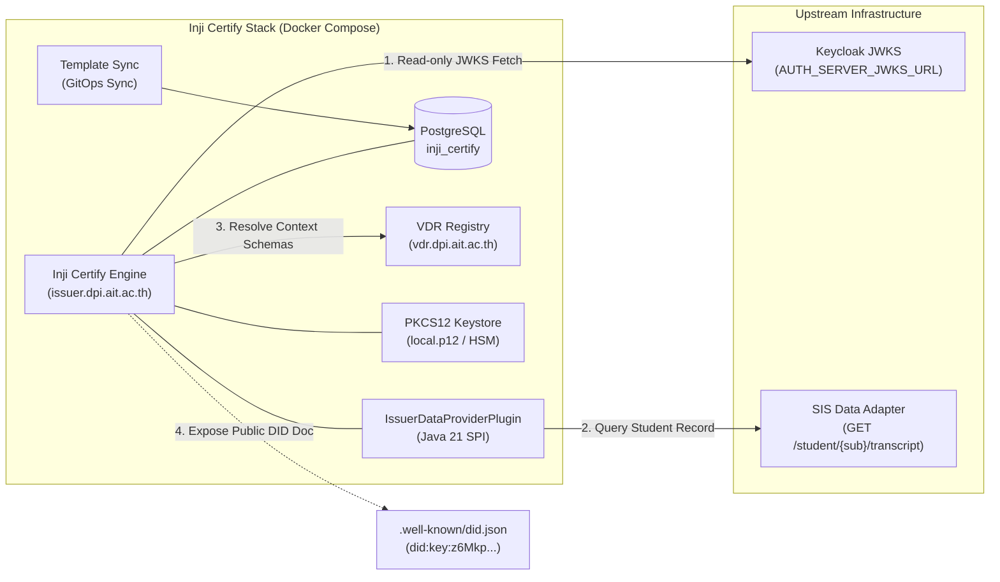

# Stage 1: Inji Certify Day-0 Deployment Guide

This guide covers the **initial (Day-0) deployment of Inji Certify**, the core credential issuer engine of the platform.



> [!IMPORTANT]
> **Decoupled Architecture:**
> Inji Certify is an **OAuth 2.0 Resource Server**, NOT an OAuth client.
> - Certify does **not** register as a client in Keycloak.
> - Keycloak has **zero** knowledge of Certify.
> - Certify only reads Keycloak's public keys (`AUTH_SERVER_JWKS_URL`) to verify token signatures when a wallet presents an access token.

---

## 1. Tenant Configuration Structure (`deploy/<tenant>/certify/`)

All Certify-dependent configuration for a tenant (Velocity templates, database seed SQL, properties, and verification config) is isolated under `deploy/<tenant>/certify/`:

```
deploy/ait/certify/
├── certify-installation.properties    # Certify Spring properties (adapter URL, gate toggle, timeouts)
├── certify_seed.sql                  # PostgreSQL seed inserting credential_config rows
├── vp_request_config.json            # Presentation request configuration
└── credentials/                      # Inji Certify credential definitions & Velocity templates
    ├── ait-transcript.json           # AIT Transcript: claims, scope, and Velocity signing template
    └── ait-student-id.json           # AIT Student ID Card credential definition
```

### Key Tenant Files:
1. **`credentials/*.json` (Velocity Templates)**:
   Contains the W3C credential schema, scope, and the `vc_template` Velocity template string that Certify populates when signing credentials.
2. **`certify-installation.properties`**:
   Configures Certify's `IssuerDataProviderPlugin`, specifying the `CERTIFY_RECORD_URL`, timeouts, allowed audiences, and `did-url`.
3. **`certify_seed.sql`**:
   Contains the SQL statements used to initialize or refresh the database. (Also synchronized automatically on boot by `template-sync`).

---

## 2. Upstream Data Source Integration (`sis-adapter`)

Inji Certify's `IssuerDataProviderPlugin` queries your university's Student Information System (SIS) API.

### API Contract (`docs/contracts/adapter-openapi.yaml`)

The SIS Adapter must serve:
```http
GET /student/{sub}/transcript
```
- **Path Parameter**: `{sub}` is the student's registration ID (e.g. `st120001`).
- **Response**: HTTP 200 with JSON payload:
  ```json
  {
    "registrationNo": "st120001",
    "fullName": "Nara Wattanakul",
    "gender": "Female",
    "nationality": "Thai",
    "birthDate": "1998-04-12",
    "academicProgram": "Master of Engineering in Computer Science",
    "degreeName": "Master of Engineering (M.Eng.)",
    "fieldOfStudy": "Computer Science",
    "department": "Department of Information and Communication Technologies",
    "school": "School of Engineering and Technology",
    "conferralDate": "2024-05-20",
    "enrollmentDate": "2022-08-15",
    "gpa": "3.85",
    "totalCredits": "48.0",
    "courses": [
      {
        "courseCode": "AT70.01",
        "courseName": "Data Modeling and Analysis",
        "credits": "3.0",
        "grade": "A",
        "semester": "August 2022"
      }
    ]
  }
  ```
- **Status Codes**:
  - `200 OK`: Valid student transcript.
  - `404 Not Found`: Student does not exist (Certify returns `no_record`).
  - `500 Internal Error`: Adapter error (Certify returns `adapter_error`).

---

## 3. Cryptographic Identity & Keystore Configuration (`did:key`)

### A. What is `did:key`?
`did:key` is a W3C Decentralized Identifier method where the cryptographic public key is encoded directly inside the identifier string itself:
- Format: `did:key:z6Mkp...` (for Ed25519 signing keys).
- The `z` prefix indicates Multibase Base58btc encoding, and the bytes encode the Ed25519 public key multicodec (`0xed01` prefix followed by the 32-byte public key).
- **Why this matters**: Any verifier worldwide can verify credentials issued by `did:key` completely offline without querying a blockchain or external server.

### B. Keystore Configuration
Certify loads its Ed25519 private key from the keystore mounted into `/home/inji/CERTIFY_PKCS12/local.p12`:
- Keystore file: `deploy/<tenant>/private_key/CERTIFY_PKCS12/local.p12`
- Configurable environment variables:
  ```ini
  KEYSTORE_TYPE=PKCS12
  KEYSTORE_PASS=local
  ```
  *(For production environments using a Hardware Security Module, `KEYSTORE_TYPE=PKCS11` is used).*

### C. How to Configure `CERTIFY_DID`
On startup, Inji Certify loads the keystore and exposes its live public DID document at `GET /.well-known/did.json`:

1. Start the Certify stack with default credentials.
2. Query the live DID document from Certify:
   ```bash
   curl -sf https://issuer.dpi.ait.ac.th/.well-known/did.json | jq -r .id
   # or locally via port 9091:
   curl -sf http://localhost:9091/.well-known/did.json | jq -r .id
   ```
   *Example Output:*
   ```text
   did:key:z6MkphmKx3m71Yw4NqPvxM9tX5b8cK3L2rV7u8s9T1w2Z3a4
   ```
3. Copy this string and set it in `.env`:
   ```ini
   CERTIFY_DID=did:key:z6MkphmKx3m71Yw4NqPvxM9tX5b8cK3L2rV7u8s9T1w2Z3a4
   ```

### D. How `CERTIFY_DID` is Applied
Once set in `.env`:
- **`template-sync`**: Reads `${CERTIFY_DID}` and automatically injects it into every credential configuration in the database (`credential_config.did_url`).
- **`certify-installation.properties`**: Reads `mosip.certify.data-provider-plugin.did-url=${CERTIFY_DID}` and stamps it as the `issuer.id` inside every signed Verifiable Credential.

---

## 4. Token Verification Endpoint (`AUTH_SERVER_JWKS_URL`)

### A. What is `AUTH_SERVER_JWKS_URL`?
Inji Certify is an **OAuth 2.0 Resource Server**. When a student requests a credential, their wallet presents a JWT Bearer access token issued by campus Keycloak:
- The token is signed using Keycloak's private key and carries a Key ID (`kid`) in its header.
- Certify needs Keycloak's public keys to verify that the token is genuine, has not expired, and has not been tampered with.
- Keycloak publishes its public keys at its **JSON Web Key Set (JWKS)** endpoint.

### B. How to Discover `AUTH_SERVER_JWKS_URL`
You can discover the exact JWKS endpoint using standard OpenID Connect discovery:
```bash
curl -sf https://oauth-dev.ait-itserv.dpi.ait.ac.th/realms/ait-dev/.well-known/openid-configuration | jq -r .jwks_uri
```
*Expected Output:*
```text
https://oauth-dev.ait-itserv.dpi.ait.ac.th/realms/ait-dev/protocol/openid-connect/certs
```

### C. How to Configure in `.env`
Set the discovered URLs in `.env`:
```ini
AUTH_SERVER_ISSUER=https://oauth-dev.ait-itserv.dpi.ait.ac.th/realms/ait-dev
AUTH_SERVER_JWKS_URL=https://oauth-dev.ait-itserv.dpi.ait.ac.th/realms/ait-dev/protocol/openid-connect/certs
```

### D. How Certify Validates Incoming Access Tokens (Wallet-Agnostic Design)
Inji Certify is an **OAuth 2.0 Resource Server (RS)** and is completely **wallet-agnostic**. It does not care which wallet (Inji Web, AI4DPI Mobile Wallet, or any other OpenID4VCI-compliant wallet) sends the request.

In `deploy/<tenant>/certify/certify-installation.properties`, Certify defines its allowed audiences strictly as its protected credential endpoints:
```properties
mosip.certify.authn.allowed-audiences={ 
  'http://certify-nginx:80/v1/certify/issuance/credential', 
  'http://certify-nginx/v1/certify/issuance/credential', 
  '${mosip.certify.domain.url}/v1/certify/issuance/credential' 
}
```

When any wallet calls `POST /v1/certify/issuance/credential` with `Authorization: Bearer <token>`:
1. Certify downloads Keycloak's public keys from `AUTH_SERVER_JWKS_URL` (keys are cached automatically in memory).
2. Certify matches the token's `kid` against Keycloak's public keys and verifies the cryptographic signature (e.g. RS256).
3. Certify validates that `token.iss == AUTH_SERVER_ISSUER`.
4. **Audience Verification**: Certify verifies that `token.aud` matches any of its allowed credential endpoints (`${mosip.certify.domain.url}/v1/certify/issuance/credential`). Certify accepts it from **any** wallet client whose token targets this endpoint.
5. Certify extracts `sub` (the student ID) and calls `IssuerDataProviderPlugin`.
6. Certify inspects `token.claims.get("client_id")` and logs the requesting client ID into `certify.ledger` for audit tracking.

If the signature fails, or if `iss` or `aud` does not match, Certify immediately returns HTTP 401 (`invalid_access_token`).

### E. Holder Key Binding Support (`did:jwk` & `did:key`)
Inji Certify supports both standard holder key binding methods in `cryptographic_binding_methods_supported`:
- **`did:jwk`**: Used by web-based wallets (e.g. Inji Web Wallet) generating browser-held ES256/RS256 keys.
- **`did:key`**: Used by native mobile wallets (e.g. AI4DPI Inji Mobile Wallet) aligned with Thailand ETDA recommendations.

During issuance, Certify extracts the holder's public key from the OpenID4VCI proof JWT header (`kid`) and binds it as the credential subject's identifier (`credentialSubject.id = "${_holderId}"`).

---

## 5. Complete `.env` Reference for Certify Day-0

```ini
# ==============================================================================
# Inji Certify Day-0 Configuration (.env)
# ==============================================================================
COMPOSE_PROJECT_NAME=vc-stack
INSTALLATION=ait

# Edge Ingress & Domains
CERTIFY_PUBLIC_BASE_URL=https://issuer.dpi.ait.ac.th
VDR_BASE_URL=https://vdr.dpi.ait.ac.th

# Cryptographic Identity & Keystore
CERTIFY_DID=did:key:z6MkpYourActualIssuerDidKeyHere
KEYSTORE_TYPE=PKCS12
KEYSTORE_PASS=local

# Upstream SIS Data Adapter (NetBird VPN or campus network)
CERTIFY_RECORD_URL=http://ait-itserv-dev-vm.netbird.selfhosted:8000/student/{sub}/transcript

# Approval Gate (Keep disabled for Day-0 to test direct adapter data retrieval first)
MOSIP_CERTIFY_GATEWAY_ENABLED=false
MOSIP_CERTIFY_GATEWAY_URL=NO GATEWAY

# Token Verification (Campus Keycloak - oauth-dev)
AUTH_SERVER_ISSUER=https://oauth-dev.ait-itserv.dpi.ait.ac.th/realms/ait-dev
AUTH_SERVER_JWKS_URL=https://oauth-dev.ait-itserv.dpi.ait.ac.th/realms/ait-dev/protocol/openid-connect/certs
```

---

## 6. Step-by-Step Day-0 Execution Runbook

### Step 1: Pre-flight Network Verification
Ensure the deployment host has network reachability to both the campus Keycloak JWKS and the SIS Adapter:
```bash
# Verify Keycloak JWKS is reachable
curl -sf https://oauth-dev.ait-itserv.dpi.ait.ac.th/realms/ait-dev/protocol/openid-connect/certs | jq .

# Verify SIS Adapter is reachable from the host (e.g. over NetBird VPN)
curl -sf http://ait-itserv-dev-vm.netbird.selfhosted:8000/student/st120001/transcript | jq .
```

### Step 2: Compile the Certify SPI Plugin JAR
Compile the Java 21 `IssuerDataProviderPlugin`:
```bash
docker compose -f compose.certify-build.yaml run --rm plugin-builder
```
Confirm that `src/issuer/target/issuer-data-provider-plugin.jar` is created.

### Step 3: Launch Certify & Trust Services
Bring up the Certify engine, PostgreSQL database, template-sync, VDR, and Traefik ingress:
```bash
docker compose -f compose.certify.yaml -f compose.trust.yaml -f compose.traefik.yaml up -d
```

### Step 4: Extract the Live `did:key` and Bind to `.env`
Query Certify's DID document to retrieve the live `did:key`:
```bash
LIVE_DID=$(curl -sf https://issuer.dpi.ait.ac.th/.well-known/did.json | jq -r .id)
echo "Live Issuer DID: $LIVE_DID"
```
If this differs from what is in `.env`, update `CERTIFY_DID` in `.env` and restart template-sync:
```bash
sed -i "s|^CERTIFY_DID=.*|CERTIFY_DID=$LIVE_DID|" .env
docker compose -f compose.certify.yaml restart template-sync service
```

### Step 5: Verify Service Health
1. **Check OpenID4VCI Issuer Discovery Endpoint**:
   ```bash
   curl -sf https://issuer.dpi.ait.ac.th/.well-known/openid-credential-issuer | jq .
   ```
   *Expected Output*: Returns JSON containing:
   - `"credential_issuer": "https://issuer.dpi.ait.ac.th"`
   - `"authorization_servers": ["https://oauth-dev.ait-itserv.dpi.ait.ac.th/realms/ait-dev"]`
   - `"credentials_supported"` containing `AitTranscriptCredential`.

2. **Check VDR Context Schema Resolution**:
   ```bash
   curl -sf https://vdr.dpi.ait.ac.th/contexts/ait-transcript/v1.json | jq .
   ```

3. **Check Certify Container Logs**:
   ```bash
   docker compose logs -f service
   ```
   Ensure Certify initializes without errors and reports `Started InjiCertifyApplication`.

---

## 7. Troubleshooting Matrix

| Symptom | Root Cause | Fix |
|---|---|---|
| **Discovery endpoint returns 404** | Certify container still booting or failed DB connection | Check `docker compose logs database` and `docker compose logs template-sync`. |
| **`invalid_access_token`** | Certify cannot reach Keycloak or `iss` mismatch | Verify `AUTH_SERVER_JWKS_URL` in `.env` is reachable from within Docker and matches token `iss`. |
| **`no_record` on issuance** | Student ID not found in SIS Adapter | Verify the student ID exists: `curl http://.../student/{sub}/transcript`. |
| **`adapter_error` on issuance** | SIS Adapter response violates OpenAPI schema | Validate JSON response matches [`docs/contracts/adapter-openapi.yaml`](../contracts/adapter-openapi.yaml). |
| **Template Sync failed** | Database was not ready or credentials JSON syntax error | Check `docker compose logs template-sync`. Verify JSON files in `deploy/ait/certify/credentials/`. |
| **Signature verification fails** | Verifier cannot resolve `did:key` or schema mismatch | Ensure `CERTIFY_DID` in `.env` matches the key loaded in Certify's keystore. |
