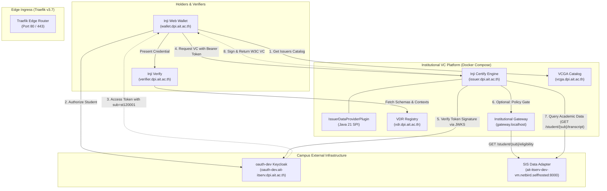

# Day-0 / First Installation & Integration Guide (Dev Environment)

This document provides a comprehensive operational runbook for executing the **initial (Day-0) installation** of the Verifiable Credential (VC) platform in the **dev** environment.

In local offline testing, the platform runs with stand-in mock services (`compose.mock.yaml`). In the **dev environment**, the platform runs against live institutional infrastructure:
1. **`oauth-dev` Keycloak**: The campus OAuth 2.0 / OpenID Connect identity provider for student single sign-on (SSO).
2. **`sis-adapter`**: The university Student Information System (SIS) API that provides academic records and eligibility status.

---

## 1. System Architecture & Component Roles



### Component Summary

| Component | Host / Domain | Responsibility |
|---|---|---|
| **Inji Certify** | `https://issuer.dpi.ait.ac.th` | OpenID4VCI issuer engine, token verification, credential signing |
| **Inji Web Wallet** | `https://wallet.dpi.ait.ac.th` | Holder digital wallet for credential discovery, claim, and export |
| **Inji Verify** | `https://verifier.dpi.ait.ac.th` | Branded verifier UI and backend for cryptographic signature verification |
| **VDR (Trust Registry)** | `https://vdr.dpi.ait.ac.th` | Static CDN serving W3C JSON-LD schemas, templates, and brand assets |
| **VCGA (Catalog)** | `https://vcga.dpi.ait.ac.th` | Issuer catalog metadata served to wallets |
| **Keycloak (`oauth-dev`)** | `https://oauth-dev.ait-itserv.dpi.ait.ac.th` | Campus identity provider; issues JWT access tokens |
| **SIS Adapter (`sis-adapter`)** | `http://ait-itserv-dev-vm.netbird.selfhosted:8000` | SIS REST API supplying student transcript records |

---

## 2. Integration 1: Identity Provider (`oauth-dev` Keycloak)

Inji Certify validates incoming Bearer access tokens against Keycloak using standard OIDC discovery and JWKS.

### A. Keycloak Configuration (on `oauth-dev` Server)
In the campus Keycloak realm (e.g. `ait-dev` at `https://oauth-dev.ait-itserv.dpi.ait.ac.th/realms/ait-dev`):

#### 1. Client Setup
Create or update the wallet client:
- **Client ID**: `wallet-demo` (or `inji-issuer-mimoto`).
- **Client Protocol**: `openid-connect`.
- **Client Authentication**: `OFF` (Public Client with PKCE).
- **Standard Flow Enabled**: `ON` (Authorization Code Grant).
- **Direct Access Grants Enabled**: `OFF` (or `ON` for automated CLI smoke tests).
- **Valid Redirect URIs**:
  - `https://wallet.dpi.ait.ac.th/redirect`
  - `http://wallet.localhost/redirect` (for developer laptop testing)
  - `io.mosip.residentapp.inji://oauthredirect` (for Inji Mobile Wallet)
- **Web Origins**:
  - `+` or `https://wallet.dpi.ait.ac.th` (allows browser CORS during token exchange).

#### 2. Protocol Mappers (Critical for Issuance)
By default, Keycloak assigns an internal UUID to the `sub` claim. However, Certify's `IssuerDataProviderPlugin` queries the SIS Adapter using `sub` (e.g., `GET /student/{sub}/transcript`). Therefore, **the token's `sub` claim must equal the student registration number (username)**.

Configure these three protocol mappers on the `wallet-demo` client:

1. **`sub-from-username`** (User Model Property Mapper):
   - **Mapper Type**: `User Property`
   - **Property**: `username`
   - **Token Claim Name**: `sub`
   - **Claim JSON Type**: `String`
   - **Add to Access Token**: `true`
   - **Add to ID Token**: `true`
   - **Add to UserInfo**: `true`

2. **`audience-self`** (Audience Mapper):
   - **Mapper Type**: `Audience`
   - **Included Client Audience**: `wallet-demo`
   - **Add to Access Token**: `true`
   - *(Certify requires that the access token audience matches `AUTH_SERVER_WALLET_CLIENT_ID`)*.

3. **`client_id-hardcoded`** (Hardcoded Claim Mapper):
   - **Mapper Type**: `Hardcoded claim`
   - **Token Claim Name**: `client_id`
   - **Claim Value**: `wallet-demo`
   - **Claim JSON Type**: `String`
   - **Add to Access Token**: `true`

#### 3. Client Scopes
1. Define a Client Scope for the credential:
   - **Name**: `ait_transcript_vc_ldp`
   - **Protocol**: `openid-connect`
   - **Include in token scope**: `true`
2. Add `ait_transcript_vc_ldp` as an **Optional Client Scope** under the `wallet-demo` client.

---

### B. Platform Environment Variables (`.env`)
Configure the authorization server connection in `.env`:

```ini
# Authorization Server (oauth-dev Keycloak)
AUTH_SERVER_ISSUER=https://oauth-dev.ait-itserv.dpi.ait.ac.th/realms/ait-dev
AUTH_SERVER_JWKS_URL=https://oauth-dev.ait-itserv.dpi.ait.ac.th/realms/ait-dev/protocol/openid-connect/certs
AUTH_SERVER_TOKEN_ENDPOINT=https://oauth-dev.ait-itserv.dpi.ait.ac.th/realms/ait-dev/protocol/openid-connect/token
AUTH_SERVER_PUBLIC_URL=https://oauth-dev.ait-itserv.dpi.ait.ac.th/realms/ait-dev
AUTH_SERVER_WALLET_CLIENT_ID=wallet-demo
```

### C. VCGA Catalog Synchronization
Inji Web reads [`deploy/ait/vcga/issuers.json`](../../deploy/ait/vcga/issuers.json) to locate the token endpoint:
- Run the parameterization script to sync the file with your `.env`:
  ```bash
  python3 src/tools/render_mimoto_issuers_config.py
  ```
- This updates `authorization_audience` and `proxy_token_endpoint` in `issuers.json` to point directly to `https://oauth-dev.ait-itserv.dpi.ait.ac.th/realms/ait-dev/protocol/openid-connect/token`.

---

## 3. Integration 2: Data Source (`sis-adapter`)

The SIS Adapter is the university's REST service that provides student academic records and eligibility status.

### A. API Specification
The adapter must implement the contract defined in [`docs/contracts/adapter-openapi.yaml`](../contracts/adapter-openapi.yaml):

#### 1. `GET /student/{sub}/transcript` (Mandatory)
- **Role**: Called by Certify's `IssuerDataProviderPlugin` to populate credential claims.
- **Path Parameter**: `{sub}` is the student's registration ID (e.g. `st120001`).
- **Response**: HTTP 200 with JSON payload:
  ```json
  {
    "registrationNo": "st120001",
    "fullName": "Nara Wattanakul",
    "gender": "Female",
    "nationality": "Thai",
    "birthDate": "1998-04-12",
    "academicProgram": "Master of Engineering in Computer Science",
    "degreeName": "Master of Engineering (M.Eng.)",
    "fieldOfStudy": "Computer Science",
    "department": "Department of Information and Communication Technologies",
    "school": "School of Engineering and Technology",
    "conferralDate": "2024-05-20",
    "enrollmentDate": "2022-08-15",
    "gpa": "3.85",
    "totalCredits": "48.0",
    "courses": [
      {
        "courseCode": "AT70.01",
        "courseName": "Data Modeling and Analysis",
        "credits": "3.0",
        "grade": "A",
        "semester": "August 2022"
      }
    ]
  }
  ```
- **Error Codes**:
  - `404 Not Found`: Student does not exist (Certify returns `no_record`).
  - `500 Internal Error`: SIS failure (Certify returns `adapter_error`).

#### 2. `GET /student/{sub}/eligibility` (Checklist Gate)
- **Role**: Called by the Approval Gateway when policy checklist enforcement is enabled.
- **Response**:
  ```json
  {
    "holds": [],
    "conferralStatus": "Conferred",
    "balance": "0.00"
  }
  ```
- **Checks evaluated**:
  - `no_holds`: `holds` array must be empty.
  - `conferred`: `conferralStatus` must equal `"Conferred"`.
  - `zero_balance`: `balance` must equal `"0.00"`.

---

### B. Platform Configuration (`.env`)

Configure the adapter endpoint in `.env`:
```ini
# Upstream SIS Adapter endpoint ({sub} is dynamically replaced by Certify)
CERTIFY_RECORD_URL=http://ait-itserv-dev-vm.netbird.selfhosted:8000/student/{sub}/transcript

# Policy Checklist / Approval Gate:
# Set to false initially to test direct adapter data retrieval:
MOSIP_CERTIFY_GATEWAY_ENABLED=false
MOSIP_CERTIFY_GATEWAY_URL=NO GATEWAY

# Enable once the adapter implements GET /student/{sub}/eligibility:
# MOSIP_CERTIFY_GATEWAY_ENABLED=true
# MOSIP_CERTIFY_GATEWAY_URL=http://gateway:8000
```

### C. Network Connectivity via NetBird Mesh VPN
The SIS Adapter is typically hosted on an internal campus VM (e.g. `ait-itserv-dev-vm`). 
- When the Docker host is joined to the **NetBird WireGuard mesh VPN**, non-local traffic from Docker bridge networks is routed through the host network interface.
- Test that the host can reach the adapter before starting the containers:
  ```bash
  curl -s http://ait-itserv-dev-vm.netbird.selfhosted:8000/student/st120001/transcript | jq .
  ```

---

## 4. Cryptographic Identity & Keystore Setup

Inji Certify signs Verifiable Credentials using an Ed25519 private key.

1. **Set the Issuer DID**:
   In `.env`, configure the live issuer DID:
   ```ini
   CERTIFY_DID=did:key:z6MkpYourActualIssuerDidKeyHere
   ```
2. **Keystore Configuration**:
   The default PKCS12 keystore is mounted at `/home/inji/CERTIFY_PKCS12/local.p12`. Configure the keystore type and secret in `.env`:
   ```ini
   KEYSTORE_TYPE=PKCS12
   KEYSTORE_PASS=your-keystore-password
   ```

---

## 5. Complete `.env` Blueprint for Dev

Create your `.env` file from this reference template:

```ini
# ==============================================================================
# Inji Verifiable Credential Platform - Dev Environment Configuration
# ==============================================================================

# Compose Stack
COMPOSE_PROJECT_NAME=vc-stack
INSTALLATION=ait

# Edge Ingress & FQDNs
CERTIFY_PUBLIC_BASE_URL=https://issuer.dpi.ait.ac.th
INJI_WEB_URL=https://wallet.dpi.ait.ac.th
INJI_VERIFY_URL=https://verifier.dpi.ait.ac.th
VDR_BASE_URL=https://vdr.dpi.ait.ac.th
VCGA_BASE_URL=https://vcga.dpi.ait.ac.th
TRUSTED_VCGA_URLS=https://vcga.dpi.ait.ac.th

# Cryptographic Identity & Keystore
CERTIFY_DID=did:key:z6MkpPLACEHOLDERreplaceMeViaBootstrapDidRefreshScript1
KEYSTORE_TYPE=PKCS12
KEYSTORE_PASS=local

# Upstream Data Source (SIS Adapter via NetBird VPN)
CERTIFY_RECORD_URL=http://ait-itserv-dev-vm.netbird.selfhosted:8000/student/{sub}/transcript

# Approval Gate (Policy Checklist)
MOSIP_CERTIFY_GATEWAY_ENABLED=false
MOSIP_CERTIFY_GATEWAY_URL=NO GATEWAY

# Authorization Server (oauth-dev Keycloak)
AUTH_SERVER_ISSUER=https://oauth-dev.ait-itserv.dpi.ait.ac.th/realms/ait-dev
AUTH_SERVER_JWKS_URL=https://oauth-dev.ait-itserv.dpi.ait.ac.th/realms/ait-dev/protocol/openid-connect/certs
AUTH_SERVER_TOKEN_ENDPOINT=https://oauth-dev.ait-itserv.dpi.ait.ac.th/realms/ait-dev/protocol/openid-connect/token
AUTH_SERVER_PUBLIC_URL=https://oauth-dev.ait-itserv.dpi.ait.ac.th/realms/ait-dev
AUTH_SERVER_WALLET_CLIENT_ID=wallet-demo

# Inji Verify Configuration
VERIFIER_TITLE=AIT Credential Verifier
INJI_VERIFY_PUBLIC_BASE_URL=https://verifier.dpi.ait.ac.th
INJI_VERIFY_DID_URI=did:web:localhost%3A9095:v1:verify
INJI_VERIFY_DID_PUBLIC_KEY_URI=did:web:localhost%3A9095:v1:verify#key-0
INJI_VERIFY_REDIRECT_URI=https://verifier.dpi.ait.ac.th
```

---

## 6. Step-by-Step Day-0 Installation Runbook

Execute these steps on the target development server:

### Step 1: Pre-flight Verification
Ensure prerequisite tools are installed:
```bash
docker --version         # Docker Engine 24+
docker compose version   # Docker Compose v2.20+
git --version
curl --version
jq --version
python3 --version        # Python 3.11+
```

### Step 2: Clone & Prepare Workspace
```bash
git clone https://github.com/mosip-asia/ait-transcript.git /opt/ait-transcript
cd /opt/ait-transcript
git checkout dev
```

### Step 3: Populate `.env`
```bash
cp .env.example .env
# Edit .env with your dev credentials and URLs
nano .env
```

### Step 4: Synchronize VCGA Issuer Catalog
Generate the parameterized issuer metadata for VCGA:
```bash
python3 src/tools/render_mimoto_issuers_config.py
```

### Step 5: Build Inji Certify SPI Plugin JAR
Compile the Java 21 `IssuerDataProviderPlugin`:
```bash
docker compose -f compose.certify-build.yaml run --rm plugin-builder
```
Verify that `src/issuer/target/issuer-data-provider-plugin.jar` was generated.

### Step 6: Launch Compose Stack
Start the root Compose stack (which includes Certify, Inji Web, Verify, VDR, VCGA, and Traefik):
```bash
docker compose up -d
```

### Step 7: Verify Service Health
1. **Check OpenID4VCI Issuer Discovery**:
   ```bash
   curl -sf https://issuer.dpi.ait.ac.th/.well-known/openid-credential-issuer | jq .
   ```
2. **Check VCGA Catalog**:
   ```bash
   curl -sf https://vcga.dpi.ait.ac.th/vcga/issuers.json | jq .
   ```
3. **Check VDR Context**:
   ```bash
   curl -sf https://vdr.dpi.ait.ac.th/contexts/ait-transcript/v1.json | jq .
   ```
4. **Check Web Wallet UI**:
   Open `https://wallet.dpi.ait.ac.th` in a browser.

---

## 7. Troubleshooting & Verification Matrix

| Issue | Symptom | Root Cause | Solution |
|---|---|---|---|
| **`invalid_access_token`** | Certify returns 401 during issuance | 1. Token expired<br>2. JWKS URI unreachable<br>3. `iss` mismatch | Verify `AUTH_SERVER_JWKS_URL` is accessible from the container and matches `AUTH_SERVER_ISSUER`. |
| **`no_record`** | Certify returns 404 during issuance | 1. Token `sub` is not student ID<br>2. Student ID missing in SIS | Verify Keycloak has `sub-from-username` mapper active. Check adapter: `curl http://.../student/{sub}/transcript`. |
| **`adapter_error`** | Certify returns 502 / internal error | 1. SIS Adapter payload schema invalid<br>2. Timeout reaching adapter | Validate adapter JSON against [`docs/contracts/adapter-openapi.yaml`](../contracts/adapter-openapi.yaml). |
| **Wallet CORS Error** | Browser reports CORS error on token exchange | Keycloak `Web Origins` missing wallet domain | Add `https://wallet.dpi.ait.ac.th` (or `+`) to Keycloak client `Web Origins`. |
| **Template Sync Fails** | Certify container fails on startup | Template sync container failed DB connection | Check database health: `docker compose logs database`. |
