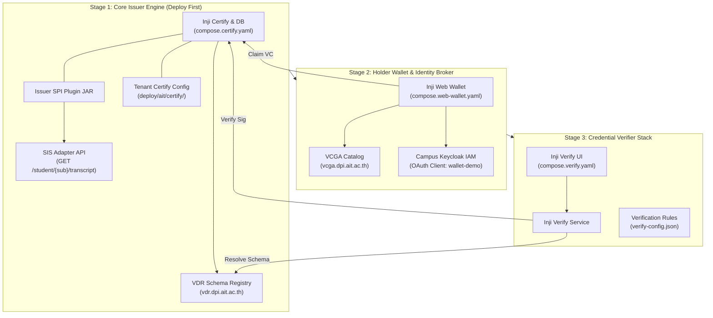

# Day-0 Deployment Roadmap & Architecture Strategy

This document outlines the **3-Stage Day-0 Deployment Strategy** for bringing up the Institutional Verifiable Credential Platform in a production-like development (`dev`) environment.

Rather than treating the platform as a monolithic stack, the deployment is structured into **three independently deployable and verifiable stages**:



---

## The 3 Modular Deployment Stages

| Stage | Target Component | Responsibility | Dedicated Runbook |
|---|---|---|---|
| **Stage 1** | **Inji Certify Engine** | Credential signing, template compilation, DB ledger, SIS adapter connection, and public JWKS token verification. | 📖 **[Stage 1: Inji Certify Day-0 Guide](./day-0-certify.md)** |
| **Stage 2** | **Inji Web Wallet** | Holder wallet interface, Keycloak OAuth Client registration (with PKCE & redirect URIs), and VCGA catalog discovery. | 📖 **[Stage 2: Inji Web Wallet Day-0 Guide](./day-0-wallet.md)** |
| **Stage 3** | **Inji Verify** | Decentralized verification interface, signature checking against issuer `did:key`, and VDR schema resolution. | 📖 **[Stage 3: Inji Verify Day-0 Guide](./day-0-verify.md)** |

---

## Architectural Principles & Decoupling

### 1. Inji Certify is an OAuth Resource Server (Not a Client)
- Certify does **not** register as a client in Keycloak.
- Keycloak has **zero** knowledge of Certify.
- Certify only needs Keycloak's public keys (`AUTH_SERVER_JWKS_URL`) to verify token signatures when a wallet requests a credential.

### 2. Wallets are OAuth Clients
- Keycloak client setup (Client IDs, Redirect URIs, Web Origins, and PKCE) is configured strictly for **holder wallets** (the Inji Web Wallet and the AI4DPI Mobile Wallet).
- Keycloak issues tokens directly to the wallet after the student logs in.

### 3. Tenant Directory Layout (`deploy/<tenant>/`)
All tenant-specific assets are organized by functional domain:
```
deploy/ait/
├── certify/                           # Certify-dependent configuration
│   ├── certify-installation.properties # Spring properties & timeouts
│   ├── certify_seed.sql               # Database seed SQL
│   ├── vp_request_config.json         # Presentation request config
│   └── credentials/                   # Credential definitions & Velocity templates
│       ├── ait-transcript.json
│       └── ait-student-id.json
├── adapter/                           # SIS adapter test data & CSV
├── vcga/                              # Issuer catalog metadata (issuers.json)
├── vdr/                               # Static schemas (@context), templates & assets
├── private_key/                       # Issuer PKCS12 / PKCS11 keystores
└── mock/                              # Stand-in Keycloak realm (offline testing only)
```

---

## Consolidated `.env` Reference for Dev Environment

```ini
# ==============================================================================
# Inji Verifiable Credential Platform - Dev Environment Baseline
# ==============================================================================
COMPOSE_PROJECT_NAME=vc-stack
INSTALLATION=ait

# Edge Ingress Domains
CERTIFY_PUBLIC_BASE_URL=https://issuer.dpi.ait.ac.th
INJI_WEB_URL=https://wallet.dpi.ait.ac.th
INJI_VERIFY_URL=https://verifier.dpi.ait.ac.th
VDR_BASE_URL=https://vdr.dpi.ait.ac.th
VCGA_BASE_URL=https://vcga.dpi.ait.ac.th
TRUSTED_VCGA_URLS=https://vcga.dpi.ait.ac.th

# Cryptographic Identity & Keystore
CERTIFY_DID=did:key:z6MkpYourActualIssuerDidKeyHere
KEYSTORE_TYPE=PKCS12
KEYSTORE_PASS=your-keystore-password

# Upstream SIS Data Adapter (NetBird VPN or campus network)
# For Day-0 Student ID deployment, point to the student-id endpoint:
CERTIFY_RECORD_URL=http://ait-itserv-dev-vm.netbird.selfhosted:8000/student/{sub}/student-id

# Approval Gate (Keep disabled for Day-0 to test direct adapter data retrieval first)
MOSIP_CERTIFY_GATEWAY_ENABLED=false
MOSIP_CERTIFY_GATEWAY_URL=NO GATEWAY

# Inji Certify (OAuth Resource Server - Token Verification)
AUTH_SERVER_ISSUER=https://oauth-dev.ait-itserv.dpi.ait.ac.th/realms/ait-dev
AUTH_SERVER_JWKS_URL=https://oauth-dev.ait-itserv.dpi.ait.ac.th/realms/ait-dev/protocol/openid-connect/certs

# Inji Web Wallet / Mimoto (OAuth Client - Stage 2 only)
AUTH_SERVER_TOKEN_ENDPOINT=https://oauth-dev.ait-itserv.dpi.ait.ac.th/realms/ait-dev/protocol/openid-connect/token
AUTH_SERVER_PUBLIC_URL=https://oauth-dev.ait-itserv.dpi.ait.ac.th/realms/ait-dev
AUTH_SERVER_WALLET_CLIENT_ID=wallet-demo  # Used only by Web Wallet (Mimoto) to initiate Keycloak login

# Inji Verify Configuration
VERIFIER_TITLE=AIT Credential Verifier
INJI_VERIFY_PUBLIC_BASE_URL=https://verifier.dpi.ait.ac.th
INJI_VERIFY_DID_URI=did:web:localhost%3A9095:v1:verify
INJI_VERIFY_DID_PUBLIC_KEY_URI=did:web:localhost%3A9095:v1:verify#key-0
INJI_VERIFY_REDIRECT_URI=https://verifier.dpi.ait.ac.th
```

---

## Where to Begin

Start with **Stage 1**:
👉 **[Proceed to Stage 1: Inji Certify Day-0 Deployment Guide](./day-0-certify.md)**
