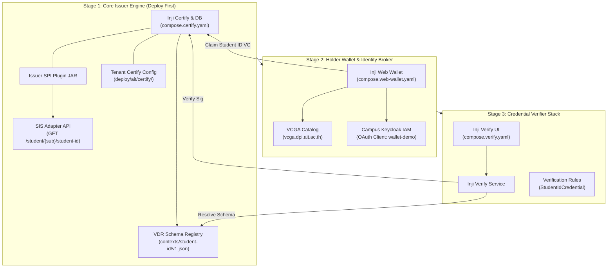

# Day-0 Deployment Roadmap & Architecture Strategy

This document outlines the **3-Stage Day-0 Deployment Strategy** for bringing up the Institutional Verifiable Credential Platform in a production-like development (`dev`) environment.

> [!IMPORTANT]
> **Day-0 Deployment Scope: Student ID Card First**
> In alignment with the institutional rollout roadmap, Day-0 deployment in the dev environment is focused strictly on the **Student ID Card** (`StudentIdCredential`, `AitIdCredential`).
> 
> The Academic Transcript (`AitTranscriptCredential`), which involves GPA calculations, course semantics, and Registrar hold checklist gates, is deferred to Phase 2 (Day-1). This ensures the core OpenID4VCI issuance, wallet claiming, and verification pipeline is fully validated first before adding academic evaluation complexity.

Rather than treating the platform as a monolithic stack, the deployment is structured into **three independently deployable and verifiable stages**:



---

## The 3 Modular Deployment Stages

| Stage | Target Component | Responsibility | Dedicated Runbook |
|---|---|---|---|
| **Stage 1** | **Inji Certify Engine** | Student ID credential signing (`StudentIdCredential`, `AitIdCredential`), template compilation, DB ledger, SIS adapter connection (`/student/{sub}/student-id`), and public JWKS token verification. | 📖 **[Stage 1: Inji Certify Day-0 Guide](./day-0-certify.md)** |
| **Stage 2** | **Inji Web Wallet** | Holder wallet interface, Keycloak OAuth Client registration (with PKCE, redirect URIs, and `ait_student_id_vc_ldp` scope), and VCGA catalog discovery. | 📖 **[Stage 2: Inji Web Wallet Day-0 Guide](./day-0-wallet.md)** |
| **Stage 3** | **Inji Verify** | Decentralized verification interface, signature checking against issuer `did:key`, and VDR schema resolution for Student ID cards. | 📖 **[Stage 3: Inji Verify Day-0 Guide](./day-0-verify.md)** |

---

## Architectural Principles & Decoupling

### 1. Inji Certify is an OAuth Resource Server (Not a Client)
- Certify does **not** register as a client in Keycloak.
- Keycloak has **zero** knowledge of Certify.
- Certify only needs Keycloak's public keys (`AUTH_SERVER_JWKS_URL`) to verify token signatures when a wallet requests a credential.

### 2. Wallets are OAuth Clients
- Keycloak client setup (Client IDs, Redirect URIs, Web Origins, and PKCE) is configured strictly for **holder wallets** (the Inji Web Wallet and the AI4DPI Mobile Wallet).
- Keycloak issues tokens directly to the wallet after the student logs in.

### 3. Multi-Role Campus Identity & Global Multi-Typing Pattern
- All campus roles (Students, Faculty, Staff) reside in a single LDAP directory and authenticate through the campus Keycloak realm (`ait-dev`).
- Role separation is enforced at the SIS Adapter endpoint (`GET /student/{sub}/student-id`), which returns HTTP 404 for non-students (causing Certify to fail closed with `no_record`).
- In accordance with W3C VCDM 2.0 and European Student Card (EBSI) / ISO 18013-5 mdoc standards, the credential issues with dual credential types:
  ```json
  "type": [
    "VerifiableCredential",
    "StudentIdCredential",
    "AitIdCredential"
  ]
  ```
  - `AitIdCredential`: Anchors common institutional identity across campus systems (library, physical access, turnstiles).
  - `StudentIdCredential`: Aligns with global/external verifiers (student discounts, public transit, ETDA Thailand).
  - `"affiliation": "Student"`: Standardizes role membership within the institution, preparing the platform for future `FacultyIdCredential` and `StaffIdCredential`.

### 4. Approval Gate Bypassed for Day-0
- The Gateway checklist gate (`MOSIP_CERTIFY_GATEWAY_ENABLED=false`) is intentionally disabled for Day-0.
- Student IDs represent active enrollment status and do not require Registrar degree conferral or graduation hold checks.
- When Academic Transcripts are introduced in Phase 2, the Gateway will be activated beside the data path to enforce conferral, library holds, and financial clearance checks.

### 5. Tenant Directory Layout (`deploy/<tenant>/`)
All tenant-specific assets are organized by functional domain:
```
deploy/ait/
├── certify/                           # Certify-dependent configuration
│   ├── certify-installation.properties # Spring properties & timeouts
│   ├── certify_seed.sql               # Database seed SQL
│   ├── vp_request_config.json         # Presentation request config
│   └── credentials/                   # Credential definitions & Velocity templates
│       ├── ait-transcript.json
│       └── ait-student-id.json
├── adapter/                           # SIS adapter test data & CSV
├── vcga/                              # Issuer catalog metadata (issuers.json)
├── vdr/                               # Static schemas (@context), templates & assets
├── private_key/                       # Issuer PKCS12 / PKCS11 keystores
└── mock/                              # Stand-in Keycloak realm (offline testing only)
```

### 6. Keystore Custody, Automatic DID Synchronization & Invariance (`did:key`)
- Inji Certify signs all credentials using the Ed25519 private key in `deploy/<tenant>/private_key/CERTIFY_PKCS12/local.p12`.
- **Automated Lifecycle (`deploy.sh`)**: The deployment runner `./scripts/deploy.sh <tenant>` automatically checks if `local.p12` exists:
  - If missing on Day-0, it auto-generates a fresh Ed25519 keystore with proper `0644` permissions.
  - It extracts the derived `did:key` (via `tools did --p12`) and automatically synchronizes `CERTIFY_DID` into `.env`.
- **Direct Keystore Reading (`template-sync`)**: The database synchronizer mounts `local.p12` into `/app/keys/CERTIFY_PKCS12/local.p12:ro`, automatically extracting the live `did:key` and seeding PostgreSQL without manual copy-pasting.

> [!CAUTION]
> **Strict Immutability Invariant:** Once credentials have been issued to students, **`local.p12` and `CERTIFY_DID` must NEVER be changed, regenerated, or deleted**.
> In W3C VCDM, the signature is cryptographically bound to the issuer `did:key`. If the key or DID changes, **ALL existing credentials become permanently unverifiable** across all external wallets and verifiers worldwide. Always back up `local.p12` and `.env` securely!

---

## Deployment Automation, Container Images & Sparse Checkout

### 1. Pre-baked Container Images from GHCR
To ensure reproducible deployments and keep build toolchains off production VMs, application components are built in CI and published to GitHub Container Registry (GHCR):
- **`ghcr.io/mosip-asia/ait-certify:${IMAGE_TAG}`**: Inji Certify 0.14 with the Java 21 `IssuerDataProviderPlugin` pre-baked at `/home/inji/additional_jars/issuer-data-provider-plugin.jar`. No host JAR compilation or bind-mounting is required at runtime.
- **`ghcr.io/mosip-asia/ait-verify-ui:${IMAGE_TAG}`**: Branded Inji Verify web interface.
- **`ghcr.io/mosip-asia/ait-vc:${IMAGE_TAG}`**: Unified multi-service Python container housing the Approval Gateway (`POST /evaluations`), Admin/Student VC Portal, VC Lab Studio (`:4200`), Developer Tools CLI (`tools`), and Database Template Sync (`certify-template-sync`). (Backward-compatibility tags `ait-vc-lab` and `ait-certify-template-sync` are also maintained).
- **`ghcr.io/mosip-asia/ait-renderer:${IMAGE_TAG}`**: VC Lab's renderer, its own copy of `ait-mimoto`'s print code and Certify's claim mapping (`src/renderer/README.md`, ADR 0002). `compose.yaml` runs it beside VC Lab on an internal network only VC Lab shares.
- **`ghcr.io/mosip-asia/ait-mimoto:${IMAGE_TAG}`**: Mimoto 0.21 (the Wallet's printer) with two changes: templates also get the claims whole, as `$credentialSubject`, and templates run under Velocity's `SecureUberspector` with strict references, so they cannot reach Java internals and a reference Velocity can't resolve fails the print (`src/mimoto/README.md`). For now only the local overlay (`compose.mimoto.yaml`) runs it.

CI builds and publishes these images via `scripts/build.sh --tag <tag> --push`. If code has not changed between tags, `build.sh` fast-retags existing GHCR images using `docker buildx imagetools create` without re-uploading layers.

### 2. Tenant Isolation & Git Sparse-Checkout
Deployment hosts only require compose manifests, deployment scripts, shared base assets (`deploy/base/`), and the specific tenant assets for that deployment (`deploy/${TENANT}/`). Other tenant directories (e.g. `deploy/hackathon/` on an `ait` server) and source code trees (`src/`, `tests/`) are excluded using Git sparse-checkout:
```bash
# Sparse checkout scoped strictly to the target tenant (e.g. TENANT=ait)
git clone --filter=blob:none --sparse https://github.com/mosip-asia/ait-issuer-platform.git .
bash scripts/sync-sparse.sh "${TENANT:-ait}"
```
The tracked script [`scripts/sync-sparse.sh`](../../scripts/sync-sparse.sh) sets up cone mode and activates tracked Git hooks in [`.githooks/`](../../.githooks/) (`post-merge` and `post-checkout`), ensuring any newly pushed compose manifests or scripts are automatically materialized upon `git pull` or automated CD checkout without requiring manual SSH intervention.
In automated CI/CD (`.github/workflows/cd.yml`), the deployment runner reads `TENANT` from the GitHub repository variable (`vars.TENANT`), ensuring each environment host only receives its own tenant files.

### 3. Automated Single-Step Deployment (`scripts/deploy.sh`)
The unified deployment script `scripts/deploy.sh` streamlines provisioning into a single command:
```bash
# Deploy with a specific image tag and tenant (e.g. ait)
./scripts/deploy.sh ait
```
- **Keystore Auto-Provisioning & DID Synchronization**: Checks for `deploy/<tenant>/private_key/CERTIFY_PKCS12/local.p12`. If missing on initial Day-0 setup, it automatically generates the Ed25519 keystore. It extracts the multibase public key and automatically synchronizes `CERTIFY_DID` in `.env`.
- **`.env` Validation**: Runs `scripts/check-env.sh` to ensure all keys defined in `.env.example` are present and critical endpoints are non-empty. Accepts either `INSTALLATION` or `TENANT`.
- **Tag & Tenant Synchronization**: Safely updates `IMAGE_TAG=<tag>` and `INSTALLATION=<tenant>` inside `.env` using inode-preserving stream writes (preventing stale Docker bind mounts).
- **Service Pull & Startup**: Pulls tagged GHCR images and starts services using Docker Compose.
- **Automated Engine Verification**: Automatically runs `scripts/smoke-test-certify.sh` to confirm database connectivity, cryptographic key loading, and OpenID4VCI discovery metadata.

### 4. Edge Ingress: HTTP (Local) vs HTTPS (Dev/Prod Server)
Edge routing is managed by Traefik v3.7 in a modular compose architecture:
- **Local Machine (HTTP)**: Uses [`compose.traefik.yaml`](../../compose.traefik.yaml) listening on HTTP port `80` (routing `*.localhost` without TLS).
- **Dev / Production Host (HTTPS with Let's Encrypt)**: Appends [`compose.traefik-tls.yaml`](../../compose.traefik-tls.yaml) to `COMPOSE_FILE`. This:
  1. Binds port `443` (HTTPS) alongside port `80` (HTTP).
  2. Provisions automated **Let's Encrypt TLS certificates** using the HTTP-01 challenge on port `80`.
  3. Automatically redirects incoming HTTP traffic on port `80` to HTTPS `443` (while preserving `/.well-known/acme-challenge/` for automated renewals).
  4. Stores certificates persistently in the `vc-stack_traefik-acme` volume (`/etc/traefik/acme/acme.json`).

> [!CAUTION]
> **Critical Let's Encrypt Invariant: Pure Public FQDNs Only**
> When `compose.traefik-tls.yaml` is active, Traefik inspects every router attached to `websecure` (port 443) and requests a certificate covering **all** domains declared in the router's `Host()` rule.
> - **Never include `*.localhost` in remote TLS rules**: Traefik submits all domains in a router rule as Subject Alternative Names (SANs) in a single ACME order. Because `.localhost` is an ICANN-reserved TLD (RFC 6761), Let's Encrypt rejects the order with HTTP 400 (`rejectedIdentifier`). Because ACME orders are atomic, the rejection of `.localhost` cancels certificate issuance for the public domain, causing Traefik to fall back to its internal self-signed `CN=TRAEFIK DEFAULT CERT`.
> - **Remote rules must declare only public FQDNs**: e.g., `TRAEFIK_CERTIFY_RULE=Host(\`issuer-dev.ait-vc.dpi.ait.ac.th\`)`.
> - **Internal Dashboard isolation**: The Traefik dashboard router is pinned to `traefik.http.routers.dashboard.entrypoints=traefik` (`:8080` / host `:8088`), ensuring it never attempts an ACME certificate request for internal/non-DNS domains.

---

### 5. Post-Deployment Verification: Smoke Test vs. Integration Test
To ensure deployments are reliable without stalling on external dependencies, tests are separated into two distinct layers:

1. **Engine Baseline Smoke Test (`scripts/smoke-test-certify.sh`)**:
   Runs automatically in CI/CD right after `docker compose up`:
   - **System Health**: Probes `/v1/certify/actuator/health` to confirm the Spring Boot application context is responsive.
   - **Cryptographic Identity & Keystore**: Validates the public DID Document (`/.well-known/did.json`) and queries `/v1/certify/.well-known/jwks.json` to confirm that all 5 active cryptographic keys (`EC`, `OKP` / `Ed25519`, `RSA`) are loaded from the database keystore.
   - **OpenID4VCI Metadata Discovery**: Queries `/.well-known/openid-credential-issuer` to verify the issuer URL, token endpoint, Keycloak authorization server, and all configured credentials (`ait-student-id` with scope `ait_student_id_vc_ldp` and `ait-transcript` with scope `ait_transcript_vc_ldp`).
   - **Revocation Registry**: Verifies that the W3C Bitstring / StatusList2021 endpoint (`/v1/certify/credentials/status-list/1`) is active.
   - *Scope*: Purely evaluates the issuer engine and database health. It requires **zero** end-user credentials, no Keycloak user login, and does not mint a Verifiable Credential.

2. **End-to-End Integration Test (`tests/test_issue_and_verify.py` / Inji Web Wallet)**:
   - Authenticates a real student persona (`st123456`) against campus Keycloak (`https://oauth-dev.ait-itserv.dpi.ait.ac.th/realms/ait-dev`) to obtain a bearer token with scope `ait_student_id_vc_ldp`.
   - Sends a `POST /v1/certify/issuance/credential` request with a signed proof JWT.
   - Certify queries the SIS Adapter (`GET /student/{sub}/student-id`), signs the W3C VCDM 2.0 credential using Ed25519, and returns the issued credential to the wallet.
   - Submits the issued VC to Inji Verify (`https://verifier-dev.ait-vc.dpi.ait.ac.th`) to verify cryptographic signatures and schema conformity against VDR.

---

## Consolidated `.env` Reference for Dev Environment (`.env.dev`)

```ini
# ==============================================================================
# Inji Verifiable Credential Platform - Remote Dev Environment Baseline (.env.dev)
# ==============================================================================
# Host: GCE Dev VM (issuer-dev-vm / issuer-dev)
# Ingress: Traefik v3.7 Edge Ingress on *.ait-vc.dpi.ait.ac.th
# Campus IAM: https://oauth-dev.ait-itserv.dpi.ait.ac.th/realms/ait-dev
# Upstream SIS: http://ait-itserv-dev-vm.netbird.selfhosted:8000
# ==============================================================================

# ------------------------------------------------------------------------------
# 0. Compose Configuration & Tenant
# ------------------------------------------------------------------------------
COMPOSE_PROJECT_NAME=vc-stack
COMPOSE_FILE=compose.database.yaml:compose.certify.yaml:compose.verify.yaml:compose.web-wallet.yaml:compose.traefik.yaml:compose.traefik-tls.yaml
INSTALLATION=ait
TENANT=ait
IMAGE_TAG=latest

# ------------------------------------------------------------------------------
# 1. Ingress & Public Base Domains
# ------------------------------------------------------------------------------
# Traefik Host Ports
TRAEFIK_WEB_PORT=80
TRAEFIK_WEBSECURE_PORT=443
TRAEFIK_DASHBOARD_PORT=8088
ACME_EMAIL=admin@dpi.ait.ac.th

# Traefik Edge Ingress Host Routing Rules (Public FQDNs only - no *.localhost in TLS rules)
TRAEFIK_CERTIFY_RULE=Host(`issuer-dev.ait-vc.dpi.ait.ac.th`)
TRAEFIK_VERIFY_RULE=Host(`verifier-dev.ait-vc.dpi.ait.ac.th`)
TRAEFIK_WALLET_RULE=Host(`wallet-dev.ait-vc.dpi.ait.ac.th`)
TRAEFIK_VDR_RULE=Host(`vdr.localhost`)
TRAEFIK_VCGA_RULE=Host(`vcga.localhost`)
TRAEFIK_VCLAB_RULE=Host(`lab.localhost`)
TRAEFIK_DASHBOARD_RULE=Host(`traefik.localhost`)

# Public Dev Endpoints
CERTIFY_PUBLIC_BASE_URL=https://issuer-dev.ait-vc.dpi.ait.ac.th
ISSUER_BASE_URL=https://issuer-dev.ait-vc.dpi.ait.ac.th
INJI_WEB_URL=https://wallet-dev.ait-vc.dpi.ait.ac.th
INJI_VERIFY_URL=https://verifier-dev.ait-vc.dpi.ait.ac.th
KEYCLOAK_PUBLIC_BASE_URL=https://oauth-dev.ait-itserv.dpi.ait.ac.th
VDR_BASE_URL=https://vdr.dpi.ait.ac.th
VCGA_BASE_URL=https://vcga.dpi.ait.ac.th
TRUSTED_VCGA_URLS=https://vcga.dpi.ait.ac.th

# ------------------------------------------------------------------------------
# 2. Cryptographic Identity & Keystore (IMMUTABLE ONCE ISSUANCE BEGINS)
# ------------------------------------------------------------------------------
# ⚠️ CAUTION: NEVER modify CERTIFY_DID or replace local.p12 once credentials have
# been issued. Doing so permanently invalidates all existing student credentials!
# Automatically synchronized from deploy/<tenant>/private_key/CERTIFY_PKCS12/local.p12 by deploy.sh:
CERTIFY_DID=did:key:z6MknvXD49undgXJCPeXFhVr4abNqu1S7jWqeSvis2PFr6EH
KEYSTORE_TYPE=PKCS12
KEYSTORE_PASS=local

# ------------------------------------------------------------------------------
# 3. Upstream Data Source (Dev SIS Adapter over NetBird VPN)
# ------------------------------------------------------------------------------
# Day-0 Student ID Card endpoint (Phase 2 switches to .../student/{sub}/transcript):
CERTIFY_RECORD_URL=http://ait-itserv-dev-vm.netbird.selfhosted:8000/student/{sub}/student-id

# Approval Gate (Keep disabled for Day-0 to test direct adapter data retrieval first)
MOSIP_CERTIFY_GATEWAY_ENABLED=false
MOSIP_CERTIFY_GATEWAY_URL=NO GATEWAY

# ------------------------------------------------------------------------------
# 4. Identity & Authorization Servers
# ------------------------------------------------------------------------------
# Inji Certify (OAuth Resource Server - Token Verification via JWKS)
AUTH_SERVER_ISSUER=https://oauth-dev.ait-itserv.dpi.ait.ac.th/realms/ait-dev
AUTH_SERVER_JWKS_URL=https://oauth-dev.ait-itserv.dpi.ait.ac.th/realms/ait-dev/protocol/openid-connect/certs

# Inji Web Wallet / Mimoto (OAuth Client)
AUTH_SERVER_TOKEN_ENDPOINT=https://oauth-dev.ait-itserv.dpi.ait.ac.th/realms/ait-dev/protocol/openid-connect/token
AUTH_SERVER_PUBLIC_URL=https://oauth-dev.ait-itserv.dpi.ait.ac.th/realms/ait-dev
AUTH_SERVER_WALLET_CLIENT_ID=wallet-demo

# ------------------------------------------------------------------------------
# 5. Inji Verify Configuration
# ------------------------------------------------------------------------------
VERIFIER_TITLE=AIT Credential Verifier (Dev)
INJI_VERIFY_PUBLIC_BASE_URL=https://verifier-dev.ait-vc.dpi.ait.ac.th
INJI_VERIFY_DID_URI=did:web:verifier-dev.ait-vc.dpi.ait.ac.th:v1:verify
INJI_VERIFY_DID_PUBLIC_KEY_URI=did:web:verifier-dev.ait-vc.dpi.ait.ac.th:v1:verify#key-0
INJI_VERIFY_REDIRECT_URI=https://verifier-dev.ait-vc.dpi.ait.ac.th
```

---

## Where to Begin

Start with **Stage 1**:
👉 **[Proceed to Stage 1: Inji Certify Day-0 Deployment Guide](./day-0-certify.md)**
