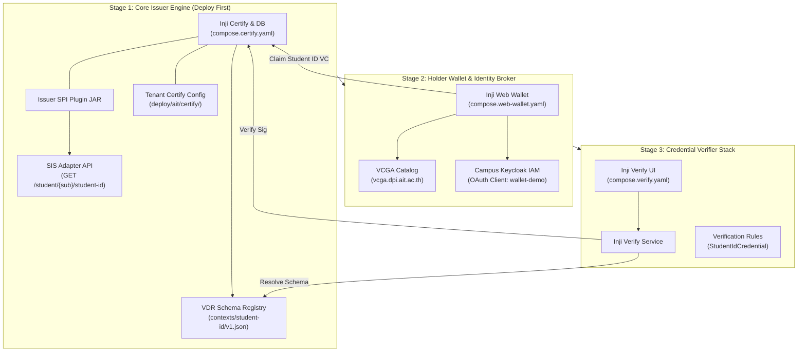

# Day-0 Deployment Roadmap & Architecture Strategy

This document outlines the **3-Stage Day-0 Deployment Strategy** for bringing up the Institutional Verifiable Credential Platform in a production-like development (`dev`) environment.

> [!IMPORTANT]
> **Day-0 Deployment Scope: Student ID Card First**
> In alignment with the institutional rollout roadmap, Day-0 deployment in the dev environment is focused strictly on the **Student ID Card** (`StudentIdCredential`, `AitIdCredential`).
> 
> The Academic Transcript (`AitTranscriptCredential`), which involves GPA calculations, course semantics, and Registrar hold checklist gates, is deferred to Phase 2 (Day-1). This ensures the core OpenID4VCI issuance, wallet claiming, and verification pipeline is fully validated first before adding academic evaluation complexity.

Rather than treating the platform as a monolithic stack, the deployment is structured into **three independently deployable and verifiable stages**:



---

## The 3 Modular Deployment Stages

| Stage | Target Component | Responsibility | Dedicated Runbook |
|---|---|---|---|
| **Stage 1** | **Inji Certify Engine** | Student ID credential signing (`StudentIdCredential`, `AitIdCredential`), template compilation, DB ledger, SIS adapter connection (`/student/{sub}/student-id`), and public JWKS token verification. | 📖 **[Stage 1: Inji Certify Day-0 Guide](./day-0-certify.md)** |
| **Stage 2** | **Inji Web Wallet** | Holder wallet interface, Keycloak OAuth Client registration (with PKCE, redirect URIs, and `ait_student_id_vc_ldp` scope), and VCGA catalog discovery. | 📖 **[Stage 2: Inji Web Wallet Day-0 Guide](./day-0-wallet.md)** |
| **Stage 3** | **Inji Verify** | Decentralized verification interface, signature checking against issuer `did:key`, and VDR schema resolution for Student ID cards. | 📖 **[Stage 3: Inji Verify Day-0 Guide](./day-0-verify.md)** |

---

## Architectural Principles & Decoupling

### 1. Inji Certify is an OAuth Resource Server (Not a Client)
- Certify does **not** register as a client in Keycloak.
- Keycloak has **zero** knowledge of Certify.
- Certify only needs Keycloak's public keys (`AUTH_SERVER_JWKS_URL`) to verify token signatures when a wallet requests a credential.

### 2. Wallets are OAuth Clients
- Keycloak client setup (Client IDs, Redirect URIs, Web Origins, and PKCE) is configured strictly for **holder wallets** (the Inji Web Wallet and the AI4DPI Mobile Wallet).
- Keycloak issues tokens directly to the wallet after the student logs in.

### 3. Multi-Role Campus Identity & Global Multi-Typing Pattern
- All campus roles (Students, Faculty, Staff) reside in a single LDAP directory and authenticate through the campus Keycloak realm (`ait-dev`).
- Role separation is enforced at the SIS Adapter endpoint (`GET /student/{sub}/student-id`), which returns HTTP 404 for non-students (causing Certify to fail closed with `no_record`).
- In accordance with W3C VCDM 2.0 and European Student Card (EBSI) / ISO 18013-5 mdoc standards, the credential issues with dual credential types:
  ```json
  "type": [
    "VerifiableCredential",
    "StudentIdCredential",
    "AitIdCredential"
  ]
  ```
  - `AitIdCredential`: Anchors common institutional identity across campus systems (library, physical access, turnstiles).
  - `StudentIdCredential`: Aligns with global/external verifiers (student discounts, public transit, ETDA Thailand).
  - `"affiliation": "Student"`: Standardizes role membership within the institution, preparing the platform for future `FacultyIdCredential` and `StaffIdCredential`.

### 4. Approval Gate Bypassed for Day-0
- The Gateway checklist gate (`MOSIP_CERTIFY_GATEWAY_ENABLED=false`) is intentionally disabled for Day-0.
- Student IDs represent active enrollment status and do not require Registrar degree conferral or graduation hold checks.
- When Academic Transcripts are introduced in Phase 2, the Gateway will be activated beside the data path to enforce conferral, library holds, and financial clearance checks.

### 5. Tenant Directory Layout (`deploy/<tenant>/`)
All tenant-specific assets are organized by functional domain:
```
deploy/ait/
├── certify/                           # Certify-dependent configuration
│   ├── certify-installation.properties # Spring properties & timeouts
│   ├── certify_seed.sql               # Database seed SQL
│   ├── vp_request_config.json         # Presentation request config
│   └── credentials/                   # Credential definitions & Velocity templates
│       ├── ait-transcript.json
│       └── ait-student-id.json
├── adapter/                           # SIS adapter test data & CSV
├── vcga/                              # Issuer catalog metadata (issuers.json)
├── vdr/                               # Static schemas (@context), templates & assets
├── private_key/                       # Issuer PKCS12 / PKCS11 keystores
└── mock/                              # Stand-in Keycloak realm (offline testing only)
```

---

## Deployment Automation, Container Images & Sparse Checkout

### 1. Pre-baked Container Images from GHCR
To ensure reproducible deployments and keep build toolchains off production VMs, application components are built in CI and published to GitHub Container Registry (GHCR):
- **`ghcr.io/mosip-asia/ait-certify:${IMAGE_TAG}`**: Inji Certify 0.14 with the Java 21 `IssuerDataProviderPlugin` pre-baked at `/home/inji/additional_jars/issuer-data-provider-plugin.jar`. No host JAR compilation or bind-mounting is required at runtime.
- **`ghcr.io/mosip-asia/ait-verify-ui:${IMAGE_TAG}`**: Branded Inji Verify web interface.
- **`ghcr.io/mosip-asia/ait-vc-lab:${IMAGE_TAG}`**: Credential lab and verification playground.
- **`certify-template-sync:local`**: Lightweight Python service built locally on demand to apply database seeds and synchronize credential templates.

CI builds and publishes these images via `scripts/build.sh --tag <tag> --push`. If code has not changed between tags, `build.sh` fast-retags existing GHCR images using `docker buildx imagetools create` without re-uploading layers.

### 2. Git Sparse-Checkout on Deployment Servers
Deployment hosts only require compose manifests, tenant assets, and deployment scripts. Source trees (`src/`, `tests/`) and developer documentation are excluded using Git sparse-checkout:
```bash
git clone --filter=blob:none --sparse https://github.com/mosip-asia/ait-issuer-platform.git .
git sparse-checkout set --cone deploy scripts docker
```
This is also automated when passing `--sparse` to `scripts/deploy.sh` or via the automated CD workflow (`.github/workflows/cd.yml`).

### 3. Automated Deployment & Pre-flight Validation
The unified deployment script `scripts/deploy.sh` streamlines provisioning:
```bash
# Deploy with a specific image tag and validate configuration
./scripts/deploy.sh --tag v0.0.6
```
- **`.env` Validation**: Runs `scripts/check-env.sh` to ensure all keys defined in `.env.example` are present and critical endpoints are non-empty.
- **Tag Synchronization**: Safely updates `IMAGE_TAG=<tag>` inside `.env` using inode-preserving stream writes (preventing stale Docker bind mounts).
- **Service Pull & Startup**: Pulls tagged GHCR images and starts services using Docker Compose.

---

## Consolidated `.env` Reference for Dev Environment

```ini
# ==============================================================================
# Inji Verifiable Credential Platform - Dev Environment Baseline
# ==============================================================================
COMPOSE_PROJECT_NAME=vc-stack
INSTALLATION=ait
IMAGE_TAG=latest

# Edge Ingress Domains
CERTIFY_PUBLIC_BASE_URL=https://issuer.dpi.ait.ac.th
INJI_WEB_URL=https://wallet.dpi.ait.ac.th
INJI_VERIFY_URL=https://verifier.dpi.ait.ac.th
VDR_BASE_URL=https://vdr.dpi.ait.ac.th
VCGA_BASE_URL=https://vcga.dpi.ait.ac.th
TRUSTED_VCGA_URLS=https://vcga.dpi.ait.ac.th

# Cryptographic Identity & Keystore
CERTIFY_DID=did:key:z6MkpYourActualIssuerDidKeyHere
KEYSTORE_TYPE=PKCS12
KEYSTORE_PASS=your-keystore-password

# Upstream SIS Data Adapter (NetBird VPN or campus network)
# For Day-0 Student ID deployment, point to the student-id endpoint:
CERTIFY_RECORD_URL=http://ait-itserv-dev-vm.netbird.selfhosted:8000/student/{sub}/student-id

# Approval Gate (Keep disabled for Day-0 to test direct adapter data retrieval first)
MOSIP_CERTIFY_GATEWAY_ENABLED=false
MOSIP_CERTIFY_GATEWAY_URL=NO GATEWAY

# Inji Certify (OAuth Resource Server - Token Verification)
AUTH_SERVER_ISSUER=https://oauth-dev.ait-itserv.dpi.ait.ac.th/realms/ait-dev
AUTH_SERVER_JWKS_URL=https://oauth-dev.ait-itserv.dpi.ait.ac.th/realms/ait-dev/protocol/openid-connect/certs

# Inji Web Wallet / Mimoto (OAuth Client - Stage 2 only)
AUTH_SERVER_TOKEN_ENDPOINT=https://oauth-dev.ait-itserv.dpi.ait.ac.th/realms/ait-dev/protocol/openid-connect/token
AUTH_SERVER_PUBLIC_URL=https://oauth-dev.ait-itserv.dpi.ait.ac.th/realms/ait-dev
AUTH_SERVER_WALLET_CLIENT_ID=wallet-demo  # Used only by Web Wallet (Mimoto) to initiate Keycloak login

# Inji Verify Configuration
VERIFIER_TITLE=AIT Credential Verifier
INJI_VERIFY_PUBLIC_BASE_URL=https://verifier.dpi.ait.ac.th
INJI_VERIFY_DID_URI=did:web:localhost%3A9095:v1:verify
INJI_VERIFY_DID_PUBLIC_KEY_URI=did:web:localhost%3A9095:v1:verify#key-0
INJI_VERIFY_REDIRECT_URI=https://verifier.dpi.ait.ac.th
```

---

## Where to Begin

Start with **Stage 1**:
👉 **[Proceed to Stage 1: Inji Certify Day-0 Deployment Guide](./day-0-certify.md)**
