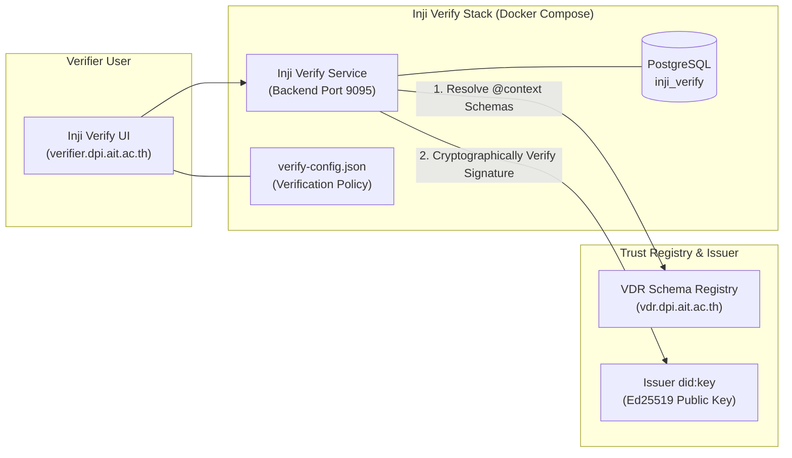

# Stage 3: Inji Verify Day-0 Deployment Guide

This guide covers the **initial (Day-0) deployment of Inji Verify**, the cryptographic verification interface for third-party verifiers, employers, and academic institutions.



---

## 1. Verifier Architecture & Configuration

Inji Verify performs independent, decentralized verification of W3C Verifiable Credentials:
1. **Signature Verification**: Verifies the `Ed25519Signature2020` cryptographic signature using the issuer's public key (resolved directly from `did:key`).
2. **Schema Validation**: Resolves and validates `@context` JSON-LD schemas from VDR (`https://vdr.dpi.ait.ac.th/contexts/...`).
3. **Status Check**: Verifies that the credential is not marked revoked on the issuer's Status List.

### Verification Rules Config (`deploy/base/verify-config.json`)
The verifier UI reads `deploy/base/verify-config.json` to determine which credential types to accept, how to request them via OpenID4VP, and in what order to render attributes:
```json
{
  "verifiableClaims": [
    {
      "logo": "/assets/cert.png",
      "name": "AIT Transcript",
      "type": "AitTranscriptCredential",
      "clientIdScheme": "did",
      "definition": {
        "purpose": "Verify the holder's AIT academic transcript credential.",
        "format": { "ldp_vc": { "proof_type": ["Ed25519Signature2020"] } },
        "input_descriptors": [
          {
            "id": "ait transcript credential",
            "format": { "ldp_vc": { "proof_type": ["Ed25519Signature2020"] } },
            "constraints": {
              "fields": [
                { "path": ["$.type"], "filter": { "type": "object", "pattern": "AitTranscriptCredential" } }
              ]
            }
          }
        ]
      }
    },
    {
      "logo": "/assets/cert.png",
      "name": "AIT Student ID",
      "type": "AitStudentIdCredential",
      "clientIdScheme": "did",
      "definition": {
        "purpose": "Verify the holder's AIT student ID card credential.",
        "format": { "ldp_vc": { "proof_type": ["Ed25519Signature2020"] } },
        "input_descriptors": [
          {
            "id": "student id credential",
            "format": { "ldp_vc": { "proof_type": ["Ed25519Signature2020"] } },
            "constraints": {
              "fields": [
                { "path": ["$.type"], "filter": { "type": "object", "pattern": "AitStudentIdCredential" } }
              ]
            }
          }
        ]
      }
    }
  ],
  "VCRenderOrders": {
    "AitTranscriptCredentialRenderOrder": [
      "fullName",
      "registrationNo",
      "academicProgram",
      "degreeAwarded",
      "dateGraduation",
      "faculty"
    ],
    "AitStudentIdCredentialRenderOrder": [
      "studentId",
      "fullName",
      "faculty",
      "academicProgram",
      "studentStatus",
      "expiryDate"
    ]
  }
}
```

---

## 2. Environment Configuration (`.env`)

Configure the following variables in `.env` for Inji Verify:

```ini
# ==============================================================================
# Inji Verify Day-0 Configuration
# ==============================================================================
VERIFIER_TITLE=AIT Credential Verifier
INJI_VERIFY_PUBLIC_BASE_URL=https://verifier.dpi.ait.ac.th
INJI_VERIFY_DID_URI=did:web:localhost%3A9095:v1:verify
INJI_VERIFY_DID_PUBLIC_KEY_URI=did:web:localhost%3A9095:v1:verify#key-0
INJI_VERIFY_REDIRECT_URI=https://verifier.dpi.ait.ac.th
VDR_BASE_URL=https://vdr.dpi.ait.ac.th
```

---

## 3. Deploy the Inji Verify Stack

Start the Verify UI, Verify backend service, and its PostgreSQL database:
```bash
docker compose -f compose.verify.yaml -f compose.trust.yaml -f compose.traefik.yaml up -d
```

---

## 4. Verification Testing

### A. Offline JSON File Verification
1. Open `https://verifier.dpi.ait.ac.th` in a browser.
2. Download or export a transcript credential JSON file from Inji Web Wallet (issued in Stage 2).
3. Drag and drop the credential JSON file into the Inji Verify web interface.
4. **Expected Result**:
   - Verification status: **`Valid`** (`allChecksSuccessful: true`).
   - Issuer verified: AIT University.
   - Claims displayed: Student Name, Registration No, Degree, GPA, Conferral Status.

### B. Mobile QR Code Presentation (OID4VP)
1. In the Verify UI, click **Scan with Inji Wallet**.
2. Scan the displayed QR code with the **AI4DPI Mobile Wallet**.
3. Confirm presentation on the mobile device.
4. Verify that the presentation resolves and displays verified claims on screen.

---

## 5. Troubleshooting Matrix

| Symptom | Root Cause | Fix |
|---|---|---|
| **`INVALID_SIGNATURE`** | Issuer private key mismatch or credential payload altered | Verify that the credential was signed by the currently configured `CERTIFY_DID`. |
| **Schema fetch failed (Network Error)** | Verify container cannot reach VDR domain (`vdr.dpi.ait.ac.th`) | Verify DNS or host resolution for VDR. Test: `docker compose exec service curl -I https://vdr.dpi.ait.ac.th/contexts/ait-transcript/v1.json`. |
| **Verify UI blank page / 502** | Verify service backend not ready | Check backend logs: `docker compose logs -f service`. Verify DB connection is healthy. |
